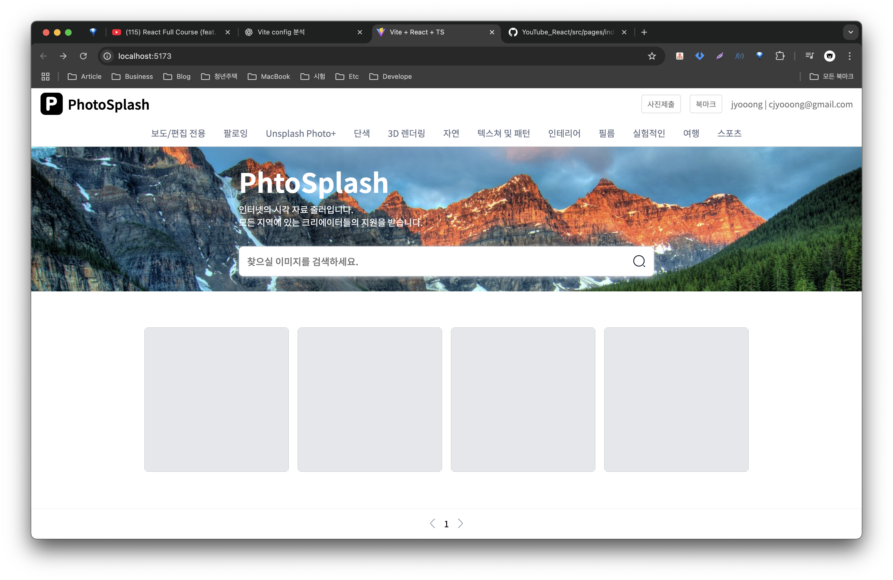

# Album(앨범) 만들기

본격적인 앨범 Single 페이지를 만들어보자.

#### 라우터 설정
**App.tsx**
```tsx
// 1. 라우팅 관련 컴포넌트 
import { BrowserRouter, Route, Routes } from "react-router-dom";

// 2. 페이지 컴포넌트
import MainPage from "@pages/index/index";

function App() {
  return (
    <BrowserRouter>
      <Routes>
        {/* 3. 베이스 url */}
        <Route path="/" element={<MainPage />}></Route>
      </Routes>
    </BrowserRouter>
  );
}

export default App;

```
- 1. `react-router-dom`에서 라우팅 관련 컴포넌트  `BrowserRouter`, `Route`, `Routes` 3개를 가져온다.
	- `BrowserRouter` : HTML5 history api를 사용하여 주소를 관리하는 라우터 컨테이너.
	- `Routes` : 여러개의 `<Route>`를 묶는 컨테이너 역할.
	- `Route` : 특정 URL 경로(`path`)와 컴포넌트 (`element`)를 매핑하는 역할.
- 2. 메인 페이지가 될 페이지 컴포넌트를 임포트하여 가져온다.
- 3. 기본 index 페이지인`/` 경로로 들어왔을 때 `<MainPage/>`가 열릴 수 있게 라우팅 한다.

#### 기본페이지 & 컴포넌트 구성
**index.tsx**
완성된 페이지가 아닌 중간 과정의 소스코드이며, 추후 진행하며 완성해 나갈 예정이다.
```tsx
import CommonFooter from "@/components/common/footer/CommonFooter";
import CommonHeader from "@/components/common/header/CommonHeader";
import CommonNav from "@/components/common/navigation/CommonNav";
import CommonSearchBar from "@/components/common/searchBar/CommonSearchBar";

import styles from "@pages/index/styles/index.module.scss";
import Card from "./component/Card";

function index() {
  return (
    <div className={styles.page}>
      {/* 공통 헤더 UI 부분 */}
      <CommonHeader />
      {/* 공통 네비게이션 UI 부분 */}
      <CommonNav />
      <div className={styles.page__contents}>
        <div className={styles.page__contents__introBox}>
          <div className={styles.wrapper}>
            <span className={styles.wrapper__title}>PhtoSplash</span>
            <span className={styles.wrapper__desc}>
              인터넷의 시각 자료 출러입니다. <br />
              모든 지역에 있는 크리에이터들의 지원을 받습니다.
            </span>
            {/* 검색창 UI 부분 */}
            <CommonSearchBar />
          </div>
        </div>
	        {/* 이미지 박스 */}
        <div className={styles.page__contents__imageBox}>
          <Card />
          <Card />
          <Card />
          <Card />
        </div>
      </div>
      {/* 공통 푸터 UI 부분 */}
      <CommonFooter />
    </div>
  );
}

export default index;

```

##### 컴포넌트 임포트
```tsx
import CommonFooter from "@/components/common/footer/CommonFooter";
import CommonHeader from "@/components/common/header/CommonHeader";
import CommonNav from "@/components/common/navigation/CommonNav";
import CommonSearchBar from "@/components/common/searchBar/CommonSearchBar";

import styles from "@pages/index/styles/index.module.scss";
import Card from "./component/Card";
```
- 현재는 만들지 않았지만 이후에 만들어야할 `CommonFooter`, `CommonHeader`, `CommonNav`,`CommonSearchBar`컴포넌트를 가져온다.
- index.tsx에서 적용될 `index.module.scss` 스타일 파일을 가져온다.
- 이미지 박스 내부에서 사용될 `Card` 컴포넌트를 가져온다.

##### header 컴포넌트
```tsx
{/* 공통 헤더 UI 부분 */}
<CommonHeader />
```

##### navigation 컴포넌트
```tsx
{/* 공통 네비게이션 UI 부분 */}
<CommonNav />
```

##### searchbar 컴포넌트
```tsx
<div className={styles.wrapper}>
    <span className={styles.wrapper__title}>PhtoSplash</span>
    <span className={styles.wrapper__desc}>
              인터넷의 시각 자료 출러입니다. <br />
              모든 지역에 있는 크리에이터들의 지원을 받습니다.
    </span>
    {/* 검색창 UI 부분 */}
    <CommonSearchBar />
</div>
```

##### 이미지박스 및 card 컴포넌트
```tsx
<div className={styles.page__contents__imageBox}>
	  <Card />
	  <Card />
	  <Card />
	  <Card />
</div>
```

##### footer 컴포넌트
```tsx
{/* 공통 푸터 UI 부분 */}
<CommonFooter />
```


위의 컴포넌트들을 완성하면 이미지와 같이 화면이 보여진다.
이제 각각의 컴포넌트 소스를 완성해 보자.

#### Header 컴포넌트
```tsx
import styles from './CommonHeader.module.scss'

function CommonHeader() {
  return (
    <div className={styles.header}>
        <div className={styles.header__logoBox}>
            
            <span className={styles.header__logoBox__title}>PhotoSplash</span>
        </div>
        <div className={styles.header__profileBox}>
            <button className={styles.header__profileBox__button}>사진제출</button>
            <button className={styles.header__profileBox__button}>북마크</button>
            <span className={styles.header__profileBox__userName}>user | user@example.com</span>

        </div>
    </div>
  )
}

export default CommonHeader
```
```scss
.header {
    display: flex;
    align-items: center;
    justify-content: space-between;

    width: 100%;
    height: 56px;

    padding: 0 16px;

    &__logoBox {
        display: flex;
        align-items: center;
        justify-content: center;

        height: 100%;

        gap: 8px;

        &__logo {
            height: 75%;
        }
        &__title {
            font-size: 24px;
            font-weight: 600;
        }
    }
    &__profileBox {
        display: flex;
        align-items: center;
        justify-content: center;

        gap: 16px;

        &__button {
            display: flex;
            align-items: center;
            justify-content: center;

            outline: none;
            cursor: pointer;

            padding: 6px 10px;

            border: 1px solid $color-white-300;
            border-radius: 4px;
            
            color: $color-white-600;
            background-color: $color-white-000;
        }
        &__userName {
            color : $color-white-600;
            font-weight: 400;
            font-size: 15px;
        }
    }
}
```

#### Navigation 컴포넌트
```tsx
import React, { useState } from 'react';
import styles from './CommonNav.module.scss'
import { Link } from 'react-router-dom';
import navJson from './nav.json';

interface Navigation {
  index: number
  path: string
  label: string
  searchValue: string
  isActive: boolean
}

function CommonNav() {
  const [navigation, setNavigation] = useState<Navigation[]>(navJson); 
  
  // useState로 선언한 반응성을 가진 데이터를 기반으로 UI를 반복호출해보도록 한다.
  const navLinks = navigation.map((item: Navigation) => {
    return (
      <Link to={item.path} className={styles.navigation__menu} key={item.path}>
            <span className={styles.navigation__menu_label}>{item.label}</span>
        </Link>
    )
  })

  return <div className={styles.navigation}>{navLinks}</div>
}

export default CommonNav
```
```scss
.navigation {
    display: flex;
    align-items: center;
    justify-content: center;

    width: 100%;
    height: 50px;

    gap: 32px;

    border-bottom: 1px solid $color-white-300;

    &__menu {
        display: flex;
        align-items: center;
        justify-content: center;

        height: 100%;

        text-decoration: none; // 추후에 div 태그를 React Router 속성 중 Link 태그로 바꿀 것이기 때문입니다.
        color: $color-white-700;
        font-weight: 500;

        &.inactive {
            color: $color-white-700;
            border-bottom: none;
        }
        &.active {
            color: $color-black-900;
            border-bottom: 2px solid $color-white-700;
        }
        &:hover {
            color: $color-black-900;
            font-weight: 600;
        }
    }
}
```

##### 컴포넌트 임포트
```tsx
import React, { useState } from 'react';
import styles from './CommonNav.module.scss'
import { Link } from 'react-router-dom';
import navJson from './nav.json';
```
- 리액트 모듈에서 `useState`를 가져온다.
- `Navigation` 모듈에서 사용할 스타일 scss를 가져온다.
- react-router-dom에서 `Link`모듈을 가져온다.
- DB 데이터 대신 사용할 Json데이터를 navJson에서 가져온다.

##### interface 선언
```typescript
interface Navigation {
  index: number
  path: string
  label: string
  searchValue: string
  isActive: boolean
}
```
- TypeScript의 인터페이스 선언으로, 객체가 가져야할 속성과 타입을 정의한다.

##### navigation 구현
```tsx
function CommonNav() {
  const [navigation, setNavigation] = useState<Navigation[]>(navJson); 
  
  // useState로 선언한 반응성을 가진 데이터를 기반으로 UI를 반복호출해보도록 한다.
  const navLinks = navigation.map((item: Navigation) => {
    return (
      <Link to={item.path} className={styles.navigation__menu} key={item.path}>
            <span className={styles.navigation__menu_label}>{item.label}</span>
        </Link>
    )
  })

  return <div className={styles.navigation}>{navLinks}</div>
}

export default CommonNav
```
- `useState` : navJson에서 가져온 네비게이션 값을 할당한다.
- `<Navigation[]>` : useState로 할당하려는 값의 자료형을 위에서 선언한 인터페이스로 제한한다.
- `navLinks` : navJson데이터를 map으로 반복하여 각 데이터별 `<Link>` 연결을 생성한다.
	- JSON으로 가져온 데이터 만큼 `<Link>` 모듈이 생성됨.
- 만들어진 navLinks를 반환하여 `CommonNav` 모듈로 사용한다.

#### SearchBar 컴포넌트
```tsx
import styles from './CommonSearchBar.module.scss'


function CommonSearchBar() {
  return (
    <div className={styles.searchBar}>
        <div className={styles.searchBar__search}>
            <input type="text" placeholder='찾으실 이미지를 검색하세요.' className={styles.searchBar__search__input} />
            
        </div>
    </div>
  )
}

export default CommonSearchBar
```
```scss
.searchBar {
    display: flex;
    align-items: center;

    gap: 28px;

    &__search {
        display: flex;
        align-items: center;
        justify-content: flex-start;

        width: 50vw;

        padding: 14px;
        gap: 16px;

        border-radius: 8px;
        border: 1px solid $color-gray-300;
        background-color: $color-white-000;
        box-shadow: 0px 2px 8px 0px rgba(228, 231, 236, 0.7);

        &:focus-within {
            border-radius: 8px;
            border: 1px solid #2e90fa;
            background-color: $color-white-000;
            box-shadow: 0px 0px 8px 0px rgba(21, 112, 239, 0.3);

            .input {
                color: $color-gray-800;
            }
        }
        &__input {
            outline: none;
            border: none;

            width: 100%;

            font-size: 17px;
            font-weight: 500;
            line-height: 17px;

            color: $color-gray-500;
        }
        img {
            cursor: pointer;
        }
    }
}
```
- Header와 Navgation과 비슷한 구조로 특별한 사항이 없으므로 코드만 보고 넘어간다.

#### Footer 컴포넌트
```tsx
import styles from './CommonFooter.module.scss'

function CommonFooter() {
  return (
    <div className={styles.footer}>
        <div className={styles.pagination}>
            <button className={styles.pagination__button}>
                
            </button>
            {/* 변경될 UI 부분 */}
            <span>1</span>
            <button className={styles.pagination__button}>
                
            </button>
        </div>
    </div>
  )
}

export default CommonFooter
```
```scss
.footer {
    display: flex;
    align-items: center;
    justify-content: center;

    width: 100%;
    height: 56px;

    padding: 0 16px;

    border: 1px solid $color-gray-100;
    background-color: $color-white-000;
}
.pagination {
    display: flex;
    align-items: center;
    justify-content: center;

    width: 100%;

    gap: 8px;

    &__button {
        display: flex;
        align-items: center;
        justify-content: center;

        width: 24px;
        height: 24px;

        padding: 3px 7px;

        color: $color-gray-500;

        font-family: 'Public Sans', sans-serif;
        font-size: 16px;
        font-weight: 700;
        line-height: 16px;

        background: transparent;
        border: none;
        outline: none;

        cursor: pointer;

        &:hover {
            background-color: $color-gray-100;
            border-radius: 4px;

            color: $color-black-900;
        }
        &.active {
            background-color: $color-gray-100;
            border-radius: 4px;

            color: $color-black-900;
        }
        &.inactive {
            background-color: $color-white-000;
            border-radius: 4px;

            color: $color-black-900;
        }
    }
}
```
- Footer 컴포넌트도 필요한 디자인과 구성이 들어있으며, 페이징처리될 구성요소들을 가지고 있다.
- 페이징처리는 추후 완성해보려한다.

#### Card 컴포넌트
```tsx
import styles from "./Card.module.scss";

function Card() {
  const openDialog = () => {
    console.log("함수 호출!");
  };
  return (
    <div className={styles.card} onClick={openDialog}>
      </img>
    </div>
  );
}

export default Card;

```
```scss
.card {
  width: 260px;
  height: 260px;

  background-color: $color-gray-200;
  border-radius: 6px;

  cursor: pointer;

  @media (min-width: 1024px) and (max-width: 1440px) {
    width: 200px;
    height: 200px;
  }

  &__image {
    width: 100%;
    height: 100%;

    border-radius: 6px;
    object-fit: cover;
  }
}
```


- api 호출
- main.jsx - api 2번 호출되는 원인
- src/pages/index/types/card.ts - 인터페이스 작성
- Card.tsx - 페이지 url prop주입
- Recoil - 개념
- Recoil을 통한 리팩토링
		- imageSelector에서 imageData 전역으로 관리
		- searchValue, pageValue get으로 얻어오기
