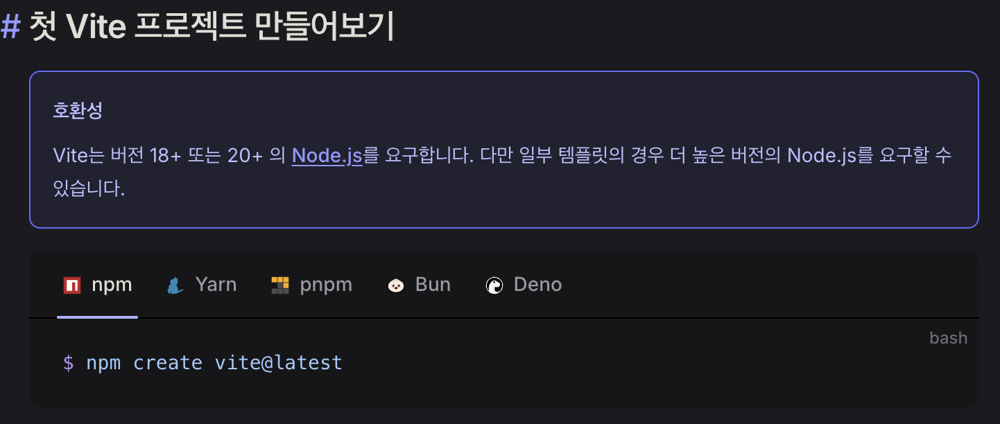
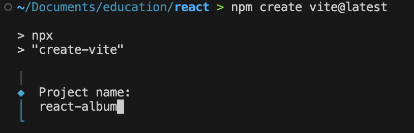
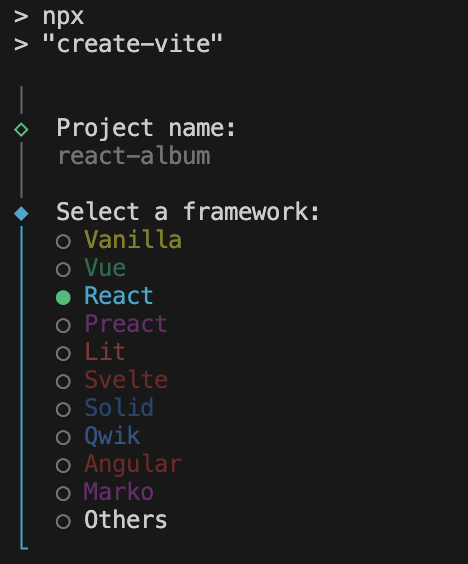
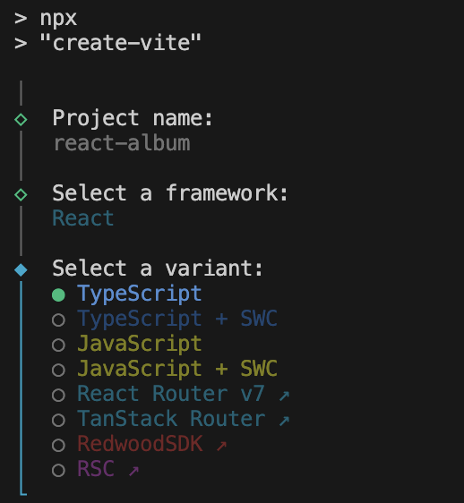
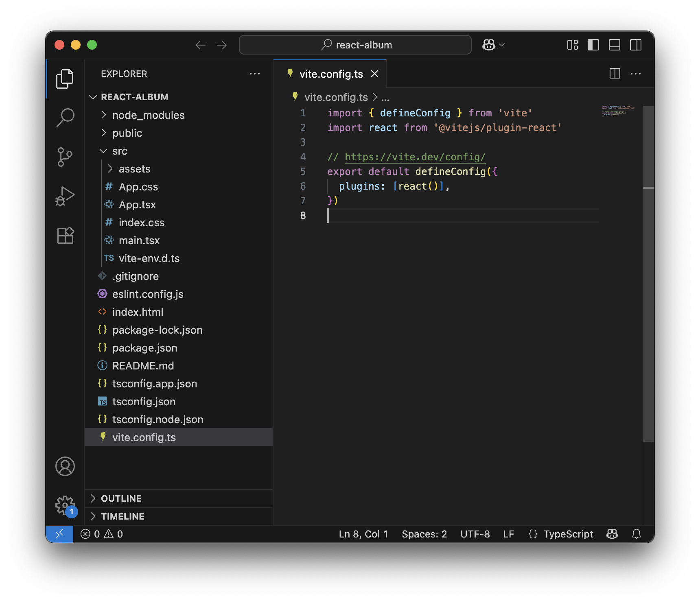
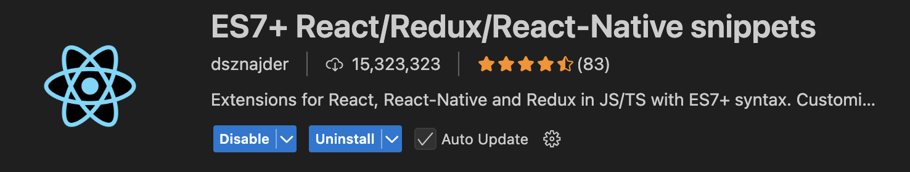
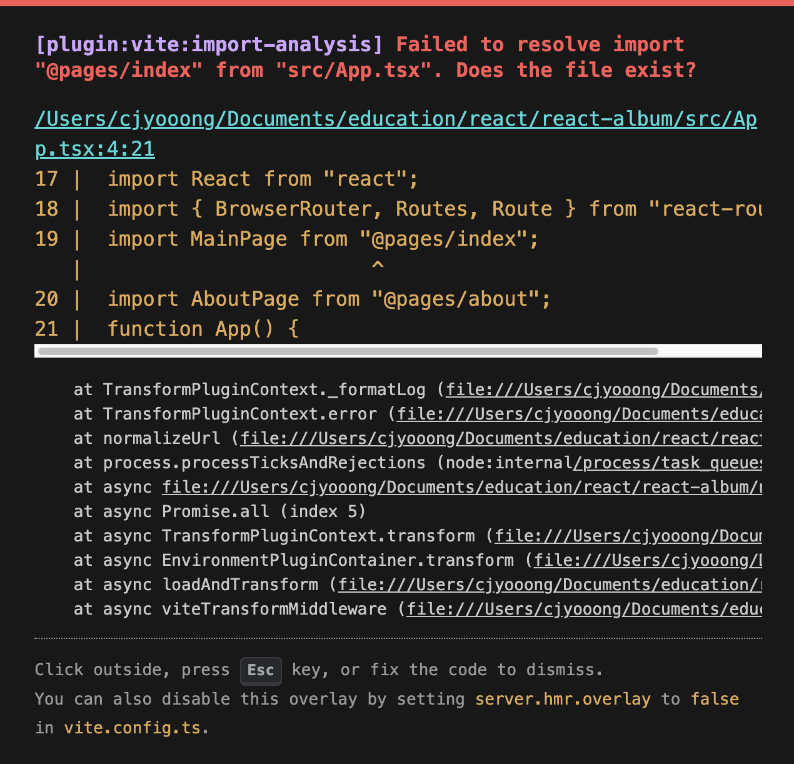

# Album(앨범) 준비

#### Vite 프로젝트 생성

https://ko.vite.dev/guide/
1. npm을 이용하여 vite프로젝트를 생성.
	
```shell
npm create vite@latest
```

 - vscode 터미널에서 프로젝트를 생성할 디렉토리로 이동.
 - 이동한 디렉토리에서 위 명령어 입력.
 - 프로젝트명 입력 : `react-album`
	 
- React 선택
	
- TypeScript 선택
	
- 생성된 프로젝트 경로 이동
```shell
cd react-album
```
 - npm 설치
 ```shell
 npm install
```
- 프로젝트열기
```shell
code . -r
```



#### 플러그인과 모듈 설치

**ES7+ React/Redux/React-Native snippets**

- 이 플러그인은 React, Redux, React-Native 개발 시 자주 사용되는 코드 조각들을 빠르게 자동완성할 수 있게 해줘서 개발 속도 향상과 반복 작업 최소화에 도움을 준다.
- `rafce`, `rcc`, `useState`, `useEffect`, `redux`관련 코드 . 등 자주 쓰는 코드들을 짧은 키워드만 입력하여 자동완성 할 수 있다.

**axios**
```shell
npm install axios
```
- axios는 브라우저와 Node.js 모두에서 동작하는 Promise 기반의 HTTP클라이언트로, 주로 API서버와 통신할 때 사용됩니다.
	[ajax VS axio](https://chatgpt.com/share/688b3ed6-6170-8008-84dd-dd99fa71fe95)


**Recoli**
중앙집중식 상태 관리를 지원하는 라이브러리
```shell
yarn add recoil
or
npm install recoil
```

- React를 위한 상태 관리 라이브러리이며, React의 컴포넌트 기반 설계와 잘 통합되도록 설계되어 있다
- [Recoil 상태관리란?](https://chatgpt.com/share/688b409a-9d58-8008-a31b-0693033f8e09)	
- 앞서 yarn이 설치되어 있지 않으면 yarn을 설치해주도록 하자.
		```shell
		brew install yarn
		```

**페이지 전환 라우터 모듈 설치** 
```shell
npm install react-router-dom localforage match-sorter sort-by
```

**TypeScript에서 Node.js 모듈 사용할 수 있는 모듈 설치**
```shell
npm install @types/node
```

**리액트 Toast Popup 모듈 설치**
```shell
npm install react-simple-toasts
```

CSS 스타일링을 위한 SASS/SCSS 설치
```shell
yarn add -D sass
or
npm install -D sass
```

#### 환경세팅
**vite.config.ts**
```typescript
import { defineConfig } from 'vite'
import react from '@vitejs/plugin-react'
import { fileURLToPath, URL } from 'url'

export default defineConfig({
	plugins: [react()],
	// vite에서 사용할 path 환경세팅
	resolve: {
	alias: {
		'@': fileURLToPath(new URL('./src', import.meta.url)),
		'@assets': fileURLToPath(new URL('./src/assets', import.meta.url)),
		'@components': fileURLToPath(new URL('./src/components', import.meta.url)),
		'@pages': fileURLToPath(new URL('./src/pages', import.meta.url)),
		'@types': fileURLToPath(new URL('./src/types', import.meta.url)),
		'@recoil': fileURLToPath(new URL('./src/recoil', import.meta.url)),
		'@apis': fileURLToPath(new URL('./src/apis', import.meta.url)),
		},
	},

// SCSS 전역 사용
css: {
	preprocessorOptions: {
		scss: {
			additionalData: '@import "./src/assets/styles/main.scss";'
			}
		}
	}
})
```

**tsconfig.app.json**
```json
// 환경세팅
"baseUrl": ".",
"paths": {
	"@/*":["src/*"],
	"@assets/*":["src/assets/*"],
	"@components/*": ["src/components/*"],
	"@pages/*": ["src/pages/*"],
	"@types/*": ["src/types/*"],
	"@recoil/*": ["src/recoil/*"],
	"@apis/*": ["src/apis/*"],
},
"noImplicitAny": false,
"strictNullChecks": false
```

이후 나머지 불필요한 css 파일을 제거하고, main.tsx와 App.tsx 파일에서 앨범 만들기의 첫 걸음을 걸어보자.

[tsconfig VS vite.ts](https://chatgpt.com/share/688b40e4-6c54-8008-8403-e8ff3fe2e796)

#### 화면 라우터 설정
main.tsx
```tsx
import { StrictMode } from 'react'
import { createRoot } from 'react-dom/client'
import App from './App.tsx'

createRoot(document.getElementById('root')!).render(
	<StrictMode>
		<App />
	</StrictMode>,
)
```
- 작성된 <App /> 컴포넌트를 root에 렌더링해준다.
- root는 index.html 파일에 위치함.

**App.tsx**
```typescript
import React from 'react'
import { BrowserRouter, Routes, Route } from 'react-router-dom'
// 페이지 컴포넌트
import MainPage from "@pages/index"
import AboutPage from "@pages/about"


function App() {
  return (
    <BrowserRouter>
      <Routes>
          {/* 베이스 url  */}
          <Route index path='/' element={ <MainPage /> }></Route>
          <Route index path='/about' element={ <AboutPage /> }></Route>
          <Route index path='/about/:id' element={ <AboutPage /> }></Route>
      </Routes>
    </BrowserRouter>
  )
}

export default App

```
- vite.config.ts에서 설정한 라우팅 설정값으로 @pages하위에 있는 index.tsx, about.tsx 파일을 불러와 MainPages, AboutPage 컴포넌트를 각 라우트 별로 렌더링한다.
- `path='/'` : 베이스주소 이면서 해당 주소로 접속시 MainPage 컴포넌트를 보여준다.
- `path='/about'` : 해당 주소로 접속시 AboutPage 컴포넌트를 보여준다.
- `path='/about/:id'` : path 파라미터와 같이 :id로 url호출시 파라미터를 전달하여 화면단에서 동일한 컴포넌트이지만 다른 조건의 화면을 렌더링할 수 있다.
	- 해당 조건은 about.tsx에서 확인할 수 있다.
	[Router 설명](https://chatgpt.com/share/688b4de6-a918-8008-88bb-0448b3af91a7)

**index.tsx**
```typescript
import React from 'react'

function index() {
  return (
    <div>메인 홈페이지 파일입니다.</div>
  )
}

export default index
```

**about.tsx**
```typescript
import React from 'react'

// react-router-dom을 이용한 파라미터 전달
import { useParams } from 'react-router-dom'

function about() {
    const { id } = useParams();
  return (
    <>
        <div>about 페이지 입니다.</div>
        {id && (
            <div>about 페이지 상세내용은 {id} 입니다.</div>
        )}
    </>
  )
}

export default about
```

#### 라우팅된 화면 오류 발생시키기

상황1 : 만약 `App.tsx` 페이지에 임포트 되어 있는 `@pages` 에 대한 라우팅 설정을 없애면 어떻게 될까?
**vite.config.ts**
```ts
import { defineConfig } from 'vite'
import react from '@vitejs/plugin-react'
import { fileURLToPath, URL } from 'url'

// https://vite.dev/config/
export default defineConfig({
  plugins: [react()],
  // vite에서 사용할 path 환경세팅
  resolve: {
    alias: {
      '@': fileURLToPath(new URL('./src', import.meta.url)),
      '@assets': fileURLToPath(new URL('./src/assets', import.meta.url)),
      '@components': fileURLToPath(new URL('./src/components', import.meta.url)),
      //'@pages': fileURLToPath(new URL('./src/pages', import.meta.url)),
      '@types': fileURLToPath(new URL('./src/types', import.meta.url)),
      '@recoil': fileURLToPath(new URL('./src/recoil', import.meta.url)),
      '@apis': fileURLToPath(new URL('./src/apis', import.meta.url)),
    },
  },
  // SCSS 전역 사용
  css: {
    preprocessorOptions: {
      scss: {
        additionalData: '@import "./src/assets/styles/main.scss";'
      }
    }
  }
})

```


- 위와 같이 vite가 `@page/index` 라는 모듈을 인식하지 못해 오류가 발생한다.
- 런타임시 페이지를 띄우지 못하고 `Fail to resolve import` 오류가 발생한다.

상황2 : 만약 `App.tsx` 페이지에 임포트 되어 있는 `@pages` 에 대한 라우팅 설정을 없애면 어떻게 될까?
```json
// 환경세팅
    "baseUrl": ".",
    "paths": {
      "@/*":["src/*"],
      "@assets/*":["src/assets/*"],
      "@components/*": ["src/components/*"],
      "@pages/*": ["src/pages/*"],
      //"@types/*": ["src/types/*"],
      "@recoil/*": ["src/recoil/*"],
      "@apis/*": ["src/apis/*"],
```

- 위와같이 `@types`에 대한 설정을 주석처리 한 후 페이지를 띄웠을때, 위와 다르게 별다른 이상이나 오류가 발생하지 않는다.
- ??????
