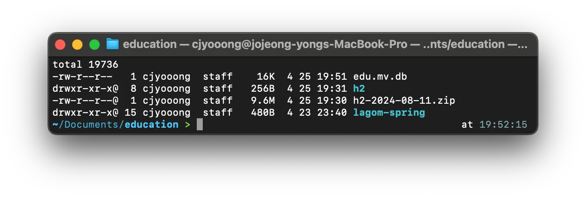
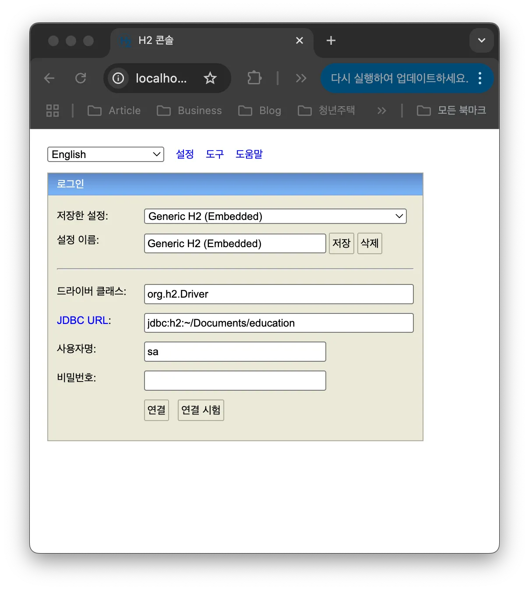
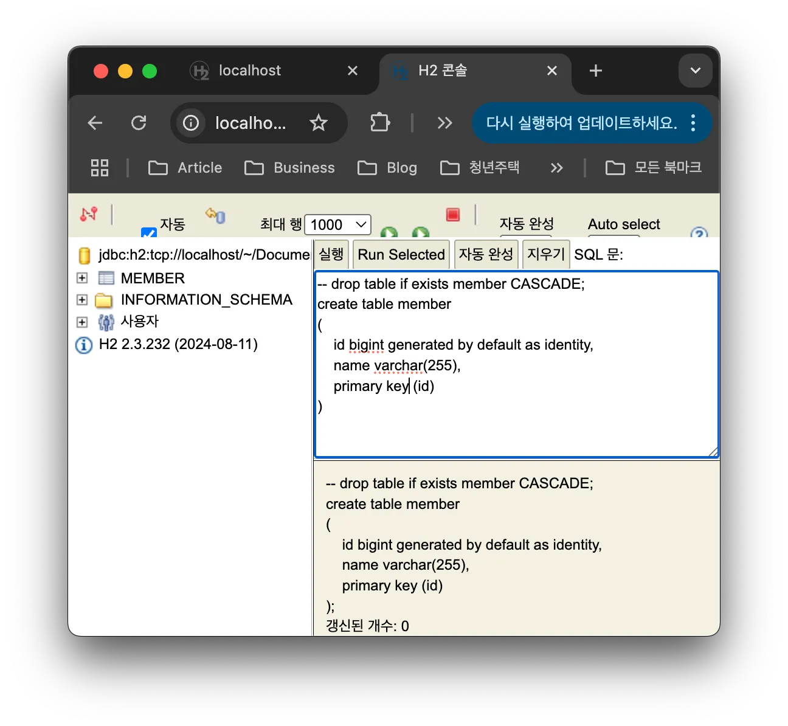
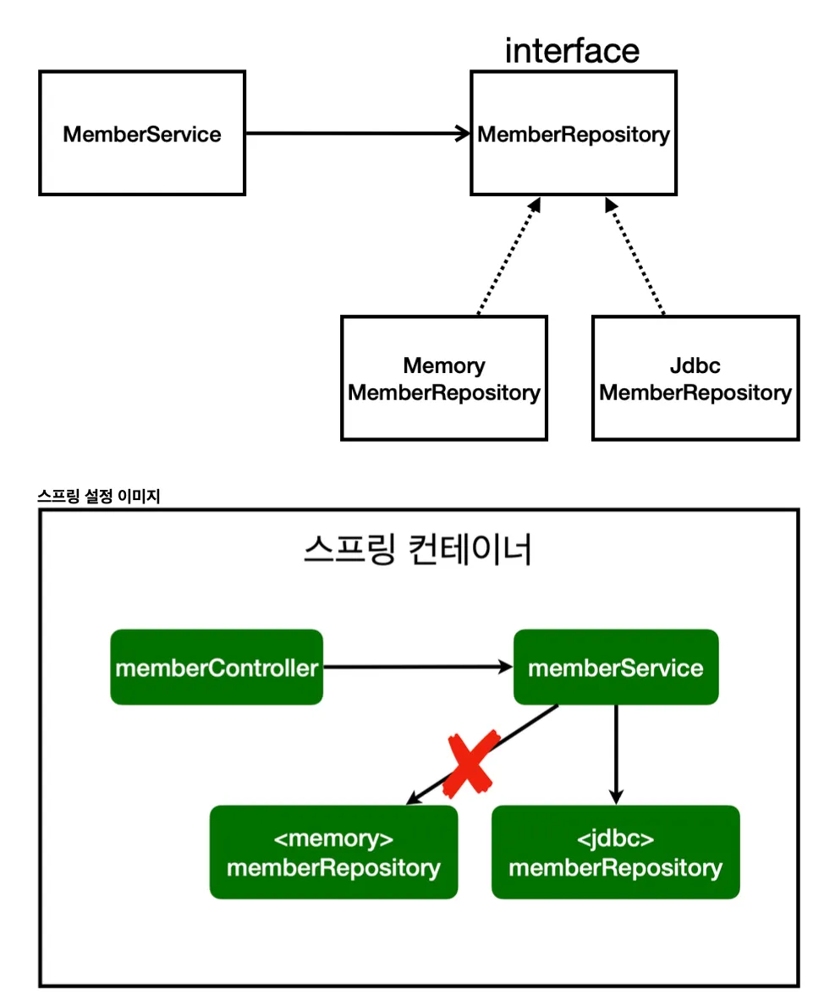

# [Spring] DB - JDBC, JPA, 스프링 데이터 JPA

> 작성일: 2025-06-26 · 태그: 프레임워크/스프링, 기초

## H2 데이터베이스 설치

여러 데이터베이스도 많지만 교육 목적으로 사용할 예정이기 때문에 H2로 설치를 진행하겠다.

[H2 Database Engine](https://www.h2database.com/html/main.html)

- H2 데이터베이스의 장단점
    
    ✅ 장점
    1. 경량화된 구조
    - 매우 가볍고 빠르며, 설치나 구성 없이 실행 가능.
    - JAR 파일 하나로 실행되므로 Java 프로젝트에 통합이 쉬움.
    
    2. 인메모리 및 임베디드 모드 지원
    - 인메모리 DB로 실행 가능하여 테스트나 임시 저장소로 매우 유용함.
    - 애플리케이션 내부에 쉽게 포함(Embedded)할 수 있어 독립 실행이 가능함.
    
    3. SQL 표준 지원
    - ANSI SQL-92 대부분을 지원하여 다른 DBMS와 유사한 방식으로 사용 가능.
    
    4. Web 콘솔 제공
    - 자체적으로 웹 기반의 관리 콘솔 제공 (`http://localhost:8082`)
        → DB 구조 확인, SQL 실행 등이 가능하여 개발 편의성 우수.
        
    
    5. 오픈소스 및 무료
    - Apache 2.0 라이선스 기반으로 자유롭게 사용 가능.
    
    6. Java와의 뛰어난 호환성
    - JDBC를 완벽히 지원하며, Java 환경에서 매우 잘 통합됨.
    
    ❌ 단점
    
    1. 대용량 데이터 처리에 한계
    - 인메모리 방식이기 때문에, 대규모 데이터를 저장하거나 처리하는 데 적합하지 않음.
    
    2. 운영 환경에 부적합
    - 주로 개발 및 테스트 목적이기 때문에, 안정성과 보안 측면에서 상용 운영 DB로는 부족.
    
    3. 동시성 처리 한계
    - 고부하 환경에서 동시 사용자 처리 능력이 제한적임 (멀티스레딩 지원이 제한적임).
    
    4. 기능의 제한
    - Oracle, PostgreSQL, MySQL 등과 비교하면 기능이 제한적임 (예: 복잡한 트리거, 파티셔닝 등 일부 고급 기능 미지원).
    
    5. 커뮤니티 및 문서 부족
    - 대형 DBMS에 비해 사용자 커뮤니티나 문서, 사례가 부족한 편.

**설치 및 DB 실행**
- 설치받은 파일 : h2-2024-08-11.zip
- 파일 압축해제 : unzip ./h2-2024-08-11.zip
- h2 폴더 생성
- ./h2/bin/ 경로의 h2.sh파일 권한부여
    chmod 755 [h2.sh](http://h2.sh)
- 데이터베이스 실행
    ./h2.sh
- 데이터베이스 파일 생성방법
    - jdbc:h2:~/Documents/education/edu (최초한번)
    - ~/Documents/education 경로 파일 생성 확인
    - 이후부터는 jdbc:h2:tcp://localhost/~/Documents/education/edu 으로 접속

⭐️ 터미널에서 실행한 h2.sh를 종료하게 되면 아래 화면으로 접속을 할 수 없다. 하지만 종료하고 다시 실행해도 데이터는 유지되어 지속해서 사용할 수 있다.

**테이블 생성**
아래의 테이블 생성 쿼리를 빈 공백에 넣어준 후 실행하게 되면 member 테이블이 생성되는 것을 확인할 수 있다.

```sql
-- drop table if exists member CASCADE;
create table member
(
    id bigint generated by default as identity,
    name varchar(255),
    primary key (id)
)
```



## 순수 Jdbc

**환경설정**
build.gradle
```bash
dependencies {
	implementation 'org.springframework.boot:spring-boot-starter-thymeleaf'
	implementation 'org.springframework.boot:spring-boot-starter-web'
	**implementation 'org.springframework.boot:spring-boot-starter-jdbc' //add spring framework jdbc
	runtimeOnly 'com.h2database:h2' // add h2 client**
	testImplementation 'org.springframework.boot:spring-boot-starter-test'
	testRuntimeOnly 'org.junit.platform:junit-platform-launcher'
}
```
jdbc, h2 데이터베이스 관련 라이브러리 추가

**데이터베이스 연결 설정 추가**
resources/application.properties
```xml
spring.application.name=lagom-spring
spring.datasource.url=jdbc:h2:tcp://localhost/~/Documents/education/edu
spring.datasource.driver-class-name=org.h2.Driver
spring.datasource.username=sa
```
- spring boot 2.4부터는 spring.datasource.username=sa를 꼭 추가해줘야한다. 추가하지 않으면 Wrong user name or password 오류가 발생

## JDBC 레포지토리 구현
20년 전 JDBC에 대한 API를 구현한 방식이며 현재에는 이렇게 사용하지 않으니 참고용으로만 기록해 두자.

- 소스 참고용
    ```java
    package lagom.lagom_spring.repository;
    
    import lagom.lagom_spring.domain.Member;
    import org.springframework.beans.factory.annotation.Autowired;
    import org.springframework.jdbc.datasource.DataSourceUtils;
    
    import javax.sql.DataSource;
    import java.sql.*;
    import java.util.ArrayList;
    import java.util.List;
    import java.util.Optional;
    
    public class JdbcMemberRepository implements MemberRepository{
        private final DataSource dataSource;
    
        @Autowired
        public JdbcMemberRepository(DataSource dataSource) {
            this.dataSource = dataSource;
        }
    
        @Override
        public Member save(Member member) {
            String sql = "insert into member(name) values(?)";
            Connection conn = null;
            PreparedStatement pstmt = null;
            ResultSet rs = null;
            try {
                conn = getConnection();
                pstmt = conn.prepareStatement(sql, Statement.RETURN_GENERATED_KEYS);
                pstmt.setString(1, member.getName());
                pstmt.executeUpdate();
                rs = pstmt.getGeneratedKeys();
                if (rs.next()) {
                    member.setId(rs.getLong(1));
                } else {
                    throw new SQLException("id 조회 실패");
                }
                return member;
            } catch (Exception e) {
                throw new IllegalStateException(e);
            } finally {
                close(conn, pstmt, rs);
            }
        }
    
        @Override
        public Optional<Member> findById(Long id) {
            String sql = "select * from member where id = ?";
            Connection conn = null;
            PreparedStatement pstmt = null;
            ResultSet rs = null;
            try {
                conn = getConnection();
                pstmt = conn.prepareStatement(sql);
                pstmt.setLong(1, id);
                rs = pstmt.executeQuery();
                if(rs.next()) {
                    Member member = new Member();
                    member.setId(rs.getLong("id"));
                    member.setName(rs.getString("name"));
                    return Optional.of(member);
                } else {
                    return Optional.empty();
                }
            } catch (Exception e) {
                throw new IllegalStateException(e);
            } finally {
                close(conn, pstmt, rs);
            }
        }
    
        @Override
        public List<Member> findAll() {
            String sql = "select * from member";
            Connection conn = null;
            PreparedStatement pstmt = null;
            ResultSet rs = null;
            try {
                conn = getConnection();
                pstmt = conn.prepareStatement(sql);
                rs = pstmt.executeQuery();
                List<Member> members = new ArrayList<>();
                while(rs.next()) {
    
                    Member member = new Member();
                    member.setId(rs.getLong("id"));
                    member.setName(rs.getString("name"));
                    members.add(member);
                }
                return members;
            } catch (Exception e) {
                throw new IllegalStateException(e);
            } finally {
                close(conn, pstmt, rs);
            }
        }
    
        @Override
        public Optional<Member> findByName(String name) {
            String sql = "select * from member where name = ?";
            Connection conn = null;
            PreparedStatement pstmt = null;
            ResultSet rs = null;
            try {
                conn = getConnection();
                pstmt = conn.prepareStatement(sql);
                pstmt.setString(1, name);
                rs = pstmt.executeQuery();
                if(rs.next()) {
                    Member member = new Member();
                    member.setId(rs.getLong("id"));
                    member.setName(rs.getString("name"));
                    return Optional.of(member);
                }
                return Optional.empty();
            } catch (Exception e) {
                throw new IllegalStateException(e);
            } finally {
                close(conn, pstmt, rs);
            }
        }
    
        private Connection getConnection() {
            return DataSourceUtils.getConnection(dataSource);
        }
    
        private void close(Connection conn, PreparedStatement pstmt, ResultSet rs) {
            try {
                if (rs != null) {
                    rs.close();
                }
            } catch (SQLException e) {
                e.printStackTrace();
            }
            try {
                if (pstmt != null) {
                    pstmt.close();
                }
            } catch (SQLException e) {
                e.printStackTrace();
            }
            try {
                if (conn != null) {
                    close(conn);
                }
            } catch (SQLException e) {
                e.printStackTrace();
            }
        }
    
        private void close(Connection conn) throws SQLException {
            DataSourceUtils.releaseConnection(conn, dataSource);
        }
    }
    
    ```

## Spring 설정 변경

lagom/lagom_spring/SpringConfig.java
```java
package lagom.lagom_spring;

import lagom.lagom_spring.repository.JdbcMemberRepository;
import lagom.lagom_spring.repository.MemberRepository;
import lagom.lagom_spring.repository.MemoryMemberRepository;
import lagom.lagom_spring.service.MemberService;
import org.springframework.beans.factory.annotation.Autowired;
import org.springframework.context.annotation.Bean;
import org.springframework.context.annotation.Configuration;

import javax.sql.DataSource;

@Configuration
public class SpringConfig {

    private final DataSource dataSource;

    @Autowired
    public SpringConfig(DataSource dataSource) {
        this.dataSource = dataSource;
    }

    @Bean
    public MemberService memberService() {
        return new MemberService(memberRepository());
    }

    @Bean
    public MemberRepository memberRepository() {
        //return new MemoryMemberRepository();
        **return new JdbcMemberRepository(dataSource);**
    }
}
```

기존에 설정해 뒀던 MemoryMemberRepository를 새로 구현한 JdbcMemberRepository로 변경하였다.


- 개방-폐쇄 원칙(OCP, Open-Closed Principle)
    - 확장에는 열려있고, 수정, 변경에는 닫혀있다.
- 스프링의 DI(Dependencies Injection)을 사용하면 기존 코드를 전혀 손대지 않고, 설정만으로 구현 클래스를 변경할 수 있다.
- 회원을 등록하고 DB에 결과가 잘 입력되는지 확인하자.
- 데이터를 DB에 저장하므로 스프링 서버를 다시 실행해도 데이터가 안전하게 저장된다.

**통합테스트**
lagom/lagom_spring/service/MemberServiceIntegrationTest.java
```java
package lagom.lagom_spring.service;

import lagom.lagom_spring.domain.Member;
import lagom.lagom_spring.repository.MemoryMemberRepository;
import org.assertj.core.api.Assertions;
import org.junit.jupiter.api.AfterEach;
import org.junit.jupiter.api.BeforeEach;
import org.junit.jupiter.api.Test;
import org.springframework.beans.factory.annotation.Autowired;
import org.springframework.boot.test.context.SpringBootTest;
import org.springframework.transaction.annotation.Transactional;

import static org.junit.jupiter.api.Assertions.assertThrows;

@SpringBootTest
@Transactional
class MemberServiceIntegrationTest {

    @Autowired MemberService memberService;
    @Autowired MemoryMemberRepository memberRepository;

    /**
     * 테스트 코드 작성시 given -> when -> then 순으로 파라미터, 시점, 결과를 확인하는 것이 좋다.
     */
    @Test
    void 회원가입() {
        //given
        Member member = new Member();
        member.setName("lagom");

        //when
        Long saveId = memberService.join(member);

        //then
        Member findMember = memberService.findOne(saveId).get();
        Assertions.assertThat(member.getName()).isEqualTo(findMember.getName());
    }

    @Test
    public void 중복_회원_예외() {
        //given
        Member member1 = new Member();
        member1.setName("lagom");

        Member member2 = new Member();
        member2.setName("lagom");

        //when
        memberService.join(member1);

        //예외 테스트 메시지 테스트
        IllegalStateException e = assertThrows(IllegalStateException.class, () -> memberService.join(member2));
        Assertions.assertThat(e.getMessage()).isEqualTo("이미 존재하는 회원입니다.");
    }

    @Test
    void findMembers() {
    }

    @Test
    void findOne() {
    }
}
```

- @SpringBootTest : 스프링 컨테이너와 테스트를 함께 실행한다.
- @Transactional : 테스트케이스에 이 어노테이션이 있으면, 테스트 시작 전에 트랜잭션을 시작하고, 테스트 완료 후에 항상 롤백한다. 이렇게 하면 DB에 데이터가 남지 않아 다음 테스트에 영향을 주지 않는다.

## 스프링 Jdbc Template

순수 Jdbc를 사용하는 것보다 코드의 수는 줄어든 Template, 즉 어느정도 규격을 갖춘 기능을 사용한다고 보면 될 것이다.

lagom/lagom_spring/repository/JdbcTemplateMemberRepository.java
```java
package lagom.lagom_spring.repository;

import lagom.lagom_spring.domain.Member;
import org.springframework.beans.factory.annotation.Autowired;
import org.springframework.jdbc.core.JdbcTemplate;
import org.springframework.jdbc.core.RowMapper;
import org.springframework.jdbc.core.namedparam.MapSqlParameterSource;
import org.springframework.jdbc.core.simple.SimpleJdbcInsert;

import javax.sql.DataSource;
import java.sql.ResultSet;
import java.sql.SQLException;
import java.util.HashMap;
import java.util.List;
import java.util.Map;
import java.util.Optional;

public class JdbcTemplateMemberRepository implements MemberRepository{

    private final JdbcTemplate jdbcTemplate;

    @Autowired
    public JdbcTemplateMemberRepository(DataSource datasource) {
        jdbcTemplate = new JdbcTemplate(datasource);
    }

    @Override
    public Member save(Member member) {
        SimpleJdbcInsert jdbcInsert = new SimpleJdbcInsert(jdbcTemplate);
        jdbcInsert.withTableName("member").usingGeneratedKeyColumns("id");
        Map<String, Object> parameters = new HashMap<>();
        parameters.put("name", member.getName());
        Number key = jdbcInsert.executeAndReturnKey(new
                MapSqlParameterSource(parameters));
        member.setId(key.longValue());
        return member;
    }

    @Override
    public Optional<Member> findById(Long id) {
        List<Member> result =  jdbcTemplate.query("select * from member where id = ?", memberRowMapper(), id);
        return result.stream().findAny();
    }

    @Override
    public Optional<Member> findByName(String name) {
        List<Member> result =  jdbcTemplate.query("select * from member where name = ?", memberRowMapper(), name);
        return result.stream().findAny();
    }

    @Override
    public List<Member> findAll() {
        return jdbcTemplate.query("select * from member", memberRowMapper());
    }

    private RowMapper<Member> memberRowMapper() {
        return (rs, rowNum) -> {
            Member member = new Member();
            member.setId(rs.getLong("id"));
            member.setName(rs.getString("name"));
            return member;
        };
    }
}
```

lagom/lagom_spring/SpringConfig.java
```java
package lagom.lagom_spring;

import lagom.lagom_spring.repository.JdbcMemberRepository;
import lagom.lagom_spring.repository.JdbcTemplateMemberRepository;
import lagom.lagom_spring.repository.MemberRepository;
import lagom.lagom_spring.repository.MemoryMemberRepository;
import lagom.lagom_spring.service.MemberService;
import org.springframework.beans.factory.annotation.Autowired;
import org.springframework.context.annotation.Bean;
import org.springframework.context.annotation.Configuration;

import javax.sql.DataSource;

@Configuration
public class SpringConfig {

    private final DataSource dataSource;

    @Autowired
    public SpringConfig(DataSource dataSource) {
        this.dataSource = dataSource;
    }

    @Bean
    public MemberService memberService() {
        return new MemberService(memberRepository());
    }

    @Bean
    public MemberRepository memberRepository() {
        //return new MemoryMemberRepository();
        //return new JdbcMemberRepository(dataSource);
        return new JdbcTemplateMemberRepository(dataSource);
    }
}

```

## 스프링 데이터 JPA
JPA는 기존의 반복 코드는 물론이고, 기본적인 SQL도 JPA가 직접 만들어서 실행하게 해준다.
- SQL과 데이터 중심의 설계 → 객체 중심의 설계
- 개발의 생산성 증대

**JPA 사용을 위한 라이브러리 추가**
```java
dependencies {
	implementation 'org.springframework.boot:spring-boot-starter-thymeleaf'
	implementation 'org.springframework.boot:spring-boot-starter-web'
	**implementation 'org.springframework.boot:spring-boot-starter-data-jpa' // add spring framwork jpa**
	//implementation 'org.springframework.boot:spring-boot-starter-jdbc' //add spring framework jdbc
	runtimeOnly 'com.h2database:h2' // add h2 client
	testImplementation 'org.springframework.boot:spring-boot-starter-test'
	testRuntimeOnly 'org.junit.platform:junit-platform-launcher'
}
```

- 기존에 추가했던 jdbc 라이브러리를 주석처리 후 jpa 관련 라이브러리를 추가
    
    주석 : implementation 'org.springframework.boot:spring-boot-starter-jdbc'
    
    추가 : implementation 'org.springframework.boot:spring-boot-starter-data-jpa'
    
- 추가한 jpa가 이전에 추가했던 jdbc라이브러리를 포함하고 있어 제외해도 DB연결하는데 문제는 없다.
    


- 라이브러리 추가 후 우측 상단에 build 가동 아이콘이 생성되니 gradle을 리로드 할 수 있게 버튼을 클릭해주자.

**JPA 사용을 위한 설정 추가**
```java
spring.application.name=lagom-spring
spring.datasource.url=jdbc:h2:tcp://localhost/~/Documents/education/edu
spring.datasource.driver-class-name=org.h2.Driver
spring.datasource.username=sa

**spring.jpa.show-sql=true
spring.jpa.hibernate.ddl-auto=none**
```
- jpa 수행시 쿼리 표시 true
- ddl-auto는 jpa가 테이블을 자동으로 생성하는 기능을 제공하는데 기존에 만들어둔 테이블이 있는경우 none으로 설정하자.
    - create를 사용하면 엔티티 정보를 바탕으로 테이블도 직접 생성해준다.

**JPA 엔티티 매핑**
```java
import jakarta.persistence.Entity;
import jakarta.persistence.GeneratedValue;
import jakarta.persistence.GenerationType;
import jakarta.persistence.Id;

**@Entity**
public class Member {

    **@Id @GeneratedValue(strategy = GenerationType.IDENTITY)**
    private Long id;
    private String name;

    public Long getId() {
        return id;
    }
```

테이블에서 사용하기 위한 Member 객체를 엔티티화 하여 사용하자.
- @Entity : 해당 객체를 JPA에서 사용하는 엔티티로 지정
- @Id : 해당 필드를 테이블에서 사용하는 유일키로 지정
- @GeneratedValue(strategy = GenerationType.IDENTITY) : 해당 키를 자동으로 생성하여 1씩 올려주는 옵션

**JPA 회원 리포지토리**
```java
package lagom.lagom_spring.repository;

import jakarta.persistence.EntityManager;
import lagom.lagom_spring.domain.Member;

import java.util.List;
import java.util.Optional;

public class JpaMemberRepository implements MemberRepository{

    **private final EntityManager em;

    public JpaMemberRepository(EntityManager em) {
        this.em = em;
    }**

    @Override
    public Member save(Member member) {
        em.persist(member);
        return member;
    }

    @Override
    public Optional<Member> findById(Long id) {
        Member member = em.find(Member.class, id);
        return Optional.ofNullable(member);
    }

    @Override
    public Optional<Member> findByName(String name) {
        List<Member> result = em.createQuery("select m from Member m where m.name = :name", Member.class)
                .setParameter("name", name)
                .getResultList();
        return result.stream().findAny();
    }

    @Override
    public List<Member> findAll() {
        return em.createQuery("select m from Member m", Member.class)
                .getResultList();
    }
}

```

**서비스 계층에 트랜잭션 추가**
```java
import org.springframework.transaction.annotation.Transactional;

import java.util.List;
import java.util.Optional;

@Service
@Transactional
public class MemberService {
```
- org.springframework.transaction.annotation.Transactional을 사용
- 스프링은 해당 클래스의 메서드를 실행할 때 트랜잭션을 시작하고, 메서드가 정상 종료되면 트랜잭션을 커밋한다. 만약 런타임 예외가 발생하면 롤백한다.
- JPA를 통한 모든 데이터 변경은 트랜잭션 안에서 실행해야 한다.

JPA를 사용하도록 스프링 설정 변경
```java
package lagom.lagom_spring;

import jakarta.persistence.EntityManager;
import lagom.lagom_spring.repository.*;
import lagom.lagom_spring.service.MemberService;
import org.springframework.beans.factory.annotation.Autowired;
import org.springframework.context.annotation.Bean;
import org.springframework.context.annotation.Configuration;

import javax.sql.DataSource;

@Configuration
public class SpringConfig {

    **private final EntityManager em;**
    private final DataSource dataSource;

    **@Autowired
    public SpringConfig(EntityManager em, DataSource dataSource) {
        this.em = em;
        this.dataSource = dataSource;
    }**

    @Bean
    public MemberService memberService() {
        return new MemberService(memberRepository());
    }

    @Bean
    public MemberRepository memberRepository() {
        //return new MemoryMemberRepository();
        //return new JdbcMemberRepository(dataSource);
        //return new JdbcTemplateMemberRepository(dataSource);
        **return new JpaMemberRepository(em);**
    }
}

```
