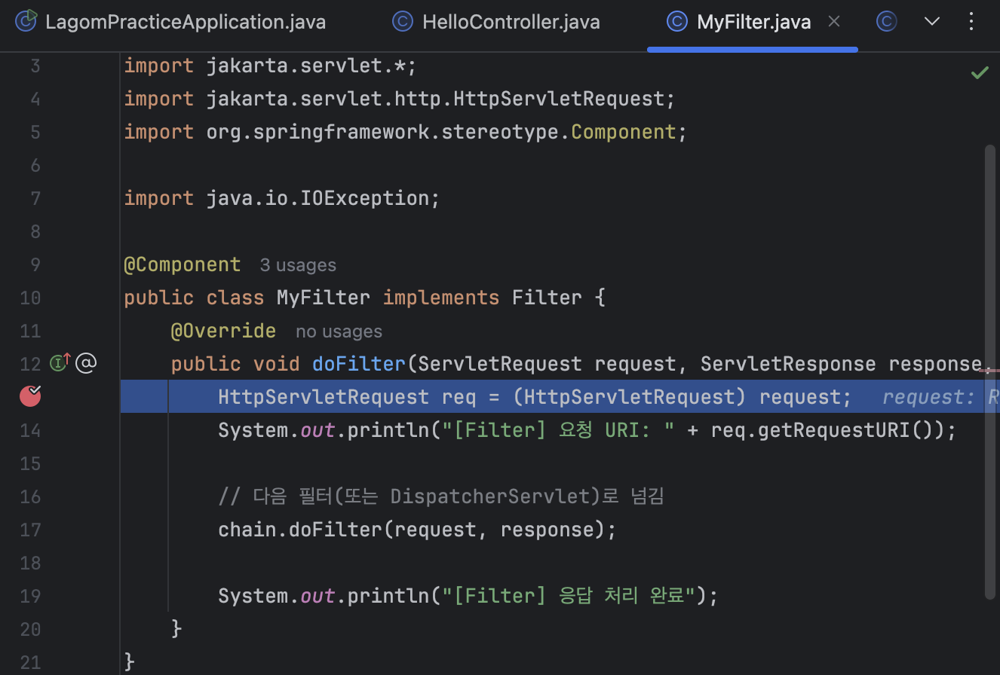
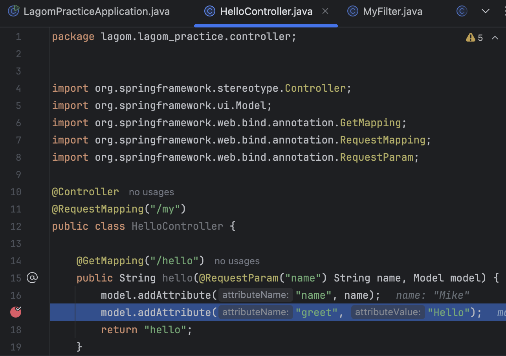

# Filter vs Interceptor

현재 아래의 표를 보면 처음 Spring Boot를 접하는 입장에서는 무슨 설명인지 이해하기 조금 어려울 수 있다. 표 다음에 `Filter`과 `Interceptor`을 읽어보고 무슨 뜻인지 다시 한번 보자.

| 구분       | Filter                                         | Interceptor                                             |
| -------- | ---------------------------------------------- | ------------------------------------------------------- |
| 위치       | ServletContainer 레벨<br>(DispatcherServlet 이전) | Spring MCV 레벨<br>(DispatcherServlet 이후)                 |
| 인터페이스    | `javax.servlet.Filter`                         | `HandlerInterceptor`                                    |
| 동작대상     | 모든 요청(정적 리소스 포함)                               | Spring Controller 요청만                                  |
| 주로 쓰는 목적 | 인증, 로깅, CORS, 인코딩 처리, 공통 처리                    | 로그인 체크, 권한 확인, 성능 로깅                                    |
| 등록 방식    | `FilterRegistrationBean` 또는 `@Componet`       | `WebMvcConfigurer.addInterceptors()`                    |
| 요청 정보 접근 | `ServletRequest`, `ServletResponse`           | `HttpServletRequest`, `HttpServletResponse`, `Handler`등 |
| 요청 중단 방법 | `chain.doFilter()`호출 여부                        | `return false` 반환                                       |

#### Filter
Filter는 `DispatcherServlet` 이전에 일어나기 때문에 `DispatcherServlet` 이후에 수행되는 Interceptor 보다 먼저 수행된다.

Filter가 어떻게 가동되는지 알아보기 위해 Controller를 구현 후 디버깅을 태워보았다.

##### 컨트롤러(controller)-뷰(view)
```Java
@Controller  
@RequestMapping("/my")  
public class HelloController {  
  
    @GetMapping("/hello")  
    public String hello(@RequestParam("name") String name, Model model) {  
        model.addAttribute("name", name);  
        model.addAttribute("greet", "Hello");  
        return "hello";  
    } 
}
```
```Html
<!DOCTYPE html>  
<html xmlns:th="http://www.thymeleaf.org">  
<head>  
    <meta charset="UTF-8">  
    <title>Hello</title>  
</head>  
<body>  
  <p th:text="${name} + ' '+ ${greet} + '!!'">name hello!!</p>  
</body>  
</html>
```

##### 필터(filter)
```Java
package lagom.lagom_practice.filter;  
  
import jakarta.servlet.*;  
import jakarta.servlet.http.HttpServletRequest;  
import org.springframework.stereotype.Component;  
  
import java.io.IOException;  
  
@Component  
public class MyFilter implements Filter {  
    @Override  
    public void doFilter(ServletRequest request, ServletResponse response, FilterChain chain) throws IOException, ServletException {  
        HttpServletRequest req = (HttpServletRequest) request;  
        System.out.println("[Filter] 요청 URI: " + req.getRequestURI());  
  
        // 다음 필터(또는 DispatcherServlet)로 넘김  
        chain.doFilter(request, response);  
  
        System.out.println("[Filter] 응답 처리 완료");  
    }  
}
```
- `Filter` : Filter를 상속받아 MyFilter에 구현체인 doFilter를 작성한다.
- `@Componet` : Spring에서 해당 클래스를 `빈(bean)`으로 등록하라는 표시이다. 해당 어노테이션을 사용하면 해당 객체가 Spring이 자동으로 생성하고 관리해 주는 대상이 된다고 보면 된다.

	- [!] `@Componet`를 Filter에 등록하게 되면 모든 요청에 대해 Filter를 수행하게 된다.  

위와 같이 Controller와 Filter 생성 후 아래 주소로 페이지 요청을 하면 doFilter -> Controller 순으로 Filter가 먼저 수행되는 것을 확인 할 수 있다.

1. MyFilter>doFilter 수행
	
2. Controller /my/hello 수행
	 

#### Filter Config
위에서 Filter에 @Component를 설정하면 모든 요청에 대해 Filter가 수행된다고 했다. 그렇다면 모든 요청(`/*`)이 아닌 특정 API 요청이 있을 때만 Filter가 수행될 수 있게 해보자. 

##### 필터(filter)
```Java
package lagom.lagom_practice.filter;  
  
import jakarta.servlet.*;  
import jakarta.servlet.http.HttpServletRequest;  
import org.springframework.stereotype.Component;  
  
import java.io.IOException;  
  
//@Component  // 특정 요청에서만 Filter가 수행될  수 있게 주석 처리
public class MyFilter implements Filter {  
    @Override  
    public void doFilter(ServletRequest request, ServletResponse response, FilterChain chain) throws IOException, ServletException {  
        HttpServletRequest req = (HttpServletRequest) request;  
        System.out.println("[Filter] 요청 URI: " + req.getRequestURI());  
  
        // 다음 필터(또는 DispatcherServlet)로 넘김  
        chain.doFilter(request, response);  
  
        System.out.println("[Filter] 응답 처리 완료");  
    }  
}
```
- 기존의 필터에서 @Component를 주석처리 하였다.

##### filter config
```Java
package lagom.lagom_practice.filter;  
  
import org.springframework.boot.web.servlet.FilterRegistrationBean;  
import org.springframework.context.annotation.Bean;  
import org.springframework.context.annotation.Configuration;  
  
@Configuration  
public class MyFilterConfig {  
  
    @Bean  
    public FilterRegistrationBean<MyFilter> loggingFilter() {  
        FilterRegistrationBean<MyFilter> registrationBean = new FilterRegistrationBean<>();  
        registrationBean.setFilter(new MyFilter());         // ① 필터 등록  
        registrationBean.addUrlPatterns("/my/bye/*");  // ② 필터를 적용할 URL 패턴 지정
        registrationBean.setOrder(1);                            //  ③ 필터 실행 순서 지정
  
        return registrationBean;                                    // ④ 등록 Bean 반환
    }  
}
```
- `@Configuration` : Spring에서 설정 클래스임을 나타내는 어노테이션이다.
	- 해당 클래스 안에서 @Bean을 통해 직접 객체를 생성하고, Spring IoC 컨테이너에 등록되도록 도와준다.
- `@Bean` : Spring에서 개발자가 직접 객체를 생성해서 Spring Bean으로 등록할 수 있게 해주는 어노테이션이다.
- `registrationBean` : 앞서 작성한 MyFilter가 "`/my/bye/*`"가 붙은 api요청에만 수행될 수 있게 구현하였다.

##### 컨트롤러(controller)
```Java
@Controller  
@RequestMapping("/my")  
public class HelloController {  

	// MyFilter 미수행
    @GetMapping("/hello")  
    public String hello(@RequestParam("name") String name, Model model) {  
        model.addAttribute("name", name);  
        model.addAttribute("greet", "Hello");  
        return "hello";  
    }
    
	// MyFilter 수행
	 @GetMapping("/bye/good")  
	public String bye(@RequestParam("name") String name, Model model) {  
	    model.addAttribute("name", name);  
	    model.addAttribute("greet", "Bye");  
	    return "hello";  
	}
}
```
MyFilter가 수행되지 않는 /my/hello와 수행되는 /my/bye/good을 작성하였다.

실제로 MyFilterConfig에 설정한 내용과 같이 /my/hello에서는 필터가 수행되지 않고 /mybye/good에서는 수행되는지 디버깅으로 확인해보자.

#### Interceptor
Interceptor는 Filter와 다르게 DispatcherServlet 이후에 일어나기 때문에 Filter가 수행된 후에 수행된다.

Interceptor구현 후 Filter와 함께 디버깅을 걸어 어떤게 더 먼저 수행되는지 파악해보자.

```Java
package lagom.lagom_practice.interceptor;  
  
import jakarta.servlet.http.HttpServletRequest;  
import jakarta.servlet.http.HttpServletResponse;  
import org.springframework.stereotype.Component;  
import org.springframework.web.servlet.HandlerInterceptor;  
import org.springframework.web.servlet.ModelAndView;  
  
@Component  
public class MyInterceptor implements HandlerInterceptor {  
  
    @Override  
    public boolean preHandle(HttpServletRequest request, HttpServletResponse response, Object handler) throws Exception {  
        System.out.println("[Interceptor] 요청 전 처리: " + request.getRequestURI());  
        //return HandlerInterceptor.super.preHandle(request, response, handler);  
        return true;  
        //return false; // false 반환하면 Controller 진입 막음 => 화면 이동이 없음.  
    }  
  
    @Override  
    public void. postHandle(HttpServletRequest request, HttpServletResponse response, Object handler, ModelAndView modelAndView) throws Exception {  
        System.out.println("[Interceptor] 컨트롤러 실행 후, View 렌더링 전환");  
        if(modelAndView != null) {  
            String originalViewName = modelAndView.getViewName();  
            System.out.println("원래 뷰 이름:" + originalViewName);  
  
            // 특정 조건에 따라 뷰 이름 변경  
            if(request.getRequestURI().contains("/my/convert")) {  
                modelAndView.setViewName("convert");  
                System.out.println("뷰가 'convert'로 변경됨.");  
            }  
        }  
        HandlerInterceptor.super.postHandle(request, response, handler, modelAndView);  
    }  
  
    @Override  
    public void. afterCompletion(HttpServletRequest request, HttpServletResponse response, Object handler, Exception ex) throws Exception {  
        System.out.println("[Interceptor] 요청 후 처리 완료");  
        //HandlerInterceptor.super.afterCompletion(request, response, handler, ex);  
    }  
}
```
- HandlerInterceptor를 상속받게 되면 3가지를 오버라이드 하고 구현체를 작성해야한다.
	
	| 메서드       | 실행 시점        | 역할      | 예외 발생 시 호출 여부    |
	| ---------- | -------------- | -------- | ---------------------- |
	| `preHandle()` | Controller 실행 전 | 요청 차단, 인증/검사, 로깅 등  | ✅ 항상 실행됨 |
	| `postHandle()` | Controller 실행 후, View 렌더링 전 | Model 조작, View 변경 등 | ❌ 예외 발생 시 실행 안 됨 |
	| `afterCompletion()` | View 렌더링 후, 요청 완료 직후 | 리소스 해제, 예외 로깅 등     | ✅ 예외 있어도 실행됨     |

##### 흐름순서도
```scss
클라이언트 요청
    ↓
preHandle()
    ↓
Controller 호출
    ↓
postHandle()         ← (정상 응답일 때만)
    ↓
View 렌더링
    ↓
afterCompletion()
    ↓
응답 완료
```

##### prehandle()
```Java
public boolean preHandle(HttpServletRequest request, HttpServletResponse response, Object handler) throws Exception {  
        System.out.println("[Interceptor] 요청 전 처리: " + request.getRequestURI());  
        //return HandlerInterceptor.super.preHandle(request, response, handler);  
        return true;  
        //return false; // false 반환하면 Controller 진입 막음 => 화면 이동이 없음.  
    } 
```
- Controller로 들어오는 요청을 차단하거나 통과시킬지 결정할 수 있음.
- false 반환 시 -> 이후 체인 중단, 컨트롤러 호출 안됨.

##### posthandle()
```Java
	@Override  
    public void. postHandle(HttpServletRequest request, HttpServletResponse response, Object handler, ModelAndView modelAndView) throws Exception {  
        System.out.println("[Interceptor] 컨트롤러 실행 후, View 렌더링 전환");  
        if(modelAndView != null) {  
            String originalViewName = modelAndView.getViewName();  
            System.out.println("원래 뷰 이름:" + originalViewName);  
  
            // 특정 조건에 따라 뷰 이름 변경  
            if(request.getRequestURI().contains("/my/convert")) {  
                modelAndView.setViewName("convert");  
                System.out.println("뷰가 'convert'로 변경됨.");  
            }  
        }  
        HandlerInterceptor.super.postHandle(request, response, handler, modelAndView);  
    } 
```
- 컨트롤러 실행 후, View 렌더링 전에 호출
- `ModelAndView`를 수정하여 뷰 이름 변경, 데이터 추가 가능

> [!CAUTION]
>단, 예외가 발생하면 postHandle은 호출되지 않음.

##### aftercompletion()
```Java
@Override  
    public void. afterCompletion(HttpServletRequest request, HttpServletResponse response, Object handler, Exception ex) throws Exception {  
        System.out.println("[Interceptor] 요청 후 처리 완료");  
        //HandlerInterceptor.super.afterCompletion(request, response, handler, ex);  
    }
```
- 뷰 렌더링까지 끝난 뒤 호출됨.
- 예외가 발생해도 반드시 호출됨.
- 로깅, 리소스 해제, DB 커넥션 종료 등에 사용.

- [!] 여기서 postHandle()과 afterCompletion()함수가 헷갈릴 수 있으니 아래를 참고하자.
	[postHandle()과 afterCompletion() 차이](../reference/postHandle%28%29%EA%B3%BC%20afterCompletion%28%29%20%EC%B0%A8%EC%9D%B4.md)
	
#### Interceptor Config
Filter와 마찬가지로 Interceptor에 @Component는 등록하게되면 모든 Controller의 요청에 수행하게 된다.

이번엔 특정 경로만 제외할 수 있는 Interceptor에 대한 Config를 만들어서 예외를 설정해보자.

##### webconfig
```Java
package lagom.lagom_practice.interceptor;  
  
import org.springframework.beans.factory.annotation.Autowired;  
import org.springframework.context.annotation.Configuration;  
import org.springframework.web.servlet.config.annotation.InterceptorRegistry;  
import org.springframework.web.servlet.config.annotation.WebMvcConfigurer;  
  
@Configuration  
public class WebConfig implements WebMvcConfigurer {  
  
    @Autowired  
    private MyInterceptor myInterceptor;  
  
    @Override  
    public void addInterceptors(InterceptorRegistry registry) {  
        registry.addInterceptor(myInterceptor)  
                .addPathPatterns("/**") // 적용경로  
                .excludePathPatterns("/my/login"); // 제외경로  
    }  
}
```
- `@Configuration` : 설정 클래스임을 Spring에게 알림.
- `WebMvcConfigurer` : Spring MVC의 다양한 설정을 커스터마이징할 수 있음.
- `@Autowired + MyInterceptor` : @Autowired를 통해 Spring 컨테이너로부터 MyInterceptor를 주입받음
	- 이 클래스는 HandlerInterceptor를 구현한 클래스여야 함.
	- 반드시 @Component 또는 @Bean으로 등록되어 있어야함.
- `InterceptorRegistry` : 이를 통해 여러 인터셉터를 순차적으로 추가할 수 있음.
- `registry.addInterceptor(myInterceptor)` : 위에서 주입받은 myInterceptor을 인터셉터 체인에 등록
	- 이제 해당 인터셉터의 preHandle(), postHandle(), afterCompletion()이 호출될 수 있음.
- `.addPathPatterns("/**")` : 모든 요청 경로에 대해 인터셉터가 동작함.
- `.excludePathPatterns("/my/login")` : /my/login 요청은 인터셉터가 무시함.
