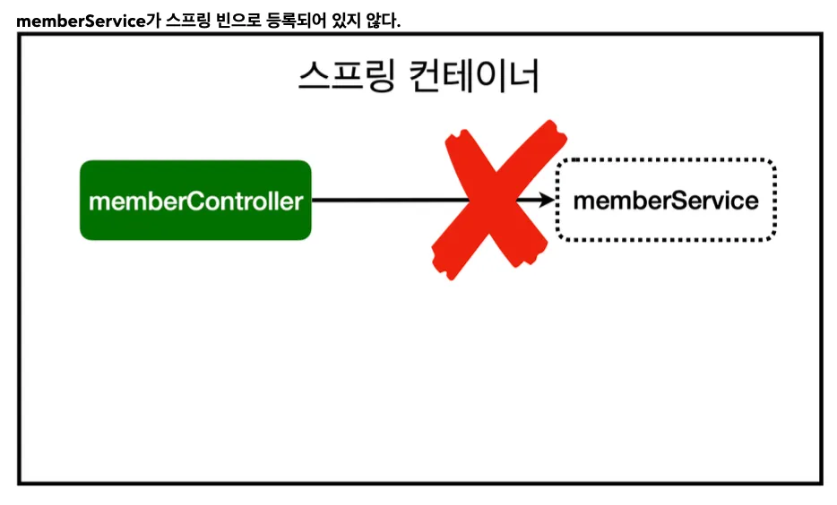
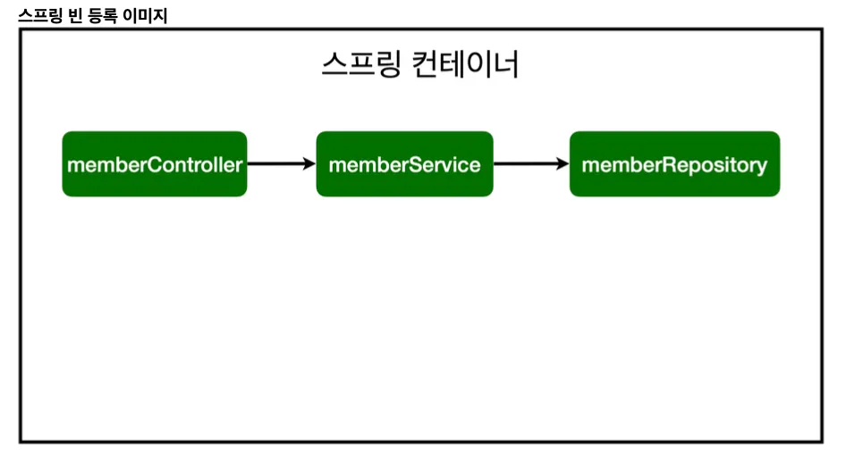

# [Spring] 컴포넌트 스캔과 자동 의존관계 설정

> 작성일: 2025-06-18 · 태그: 프레임워크/스프링, 심화

##### 컴포넌트 의존관계 설정

/lagom/lagom_spring/controller/MemberController.java

```java
package lagom.lagom_spring.controller;

import org.springframework.stereotype.Controller;

@Controller
public class MemberController {
}
```

Spring Container에서 Spring Bean을 관리하며 Spring이 가동될때 `@Controller` 가 붙어있는 MemberController객체를 생성하여 가지고 있는다.


```java
package lagom.lagom_spring.controller;

import lagom.lagom_spring.service.MemberService;
import org.springframework.stereotype.Controller;

@Controller
public class MemberController {
    MemberService memberService = new MemberService();
}
```

일반적인 Eclipse에서는 MemberService를 객채 생성하여 사용하겠지만 Spring Boot에서는 SpringContainer에 등록하여 사용해 보자.


```java
package lagom.lagom_spring.controller;

import lagom.lagom_spring.service.MemberService;
import org.springframework.beans.factory.annotation.Autowired;
import org.springframework.stereotype.Controller;

@Controller
public class MemberController {
    MemberService memberService;

    @Autowired
    public MemberController(MemberService memberService) {
        this.memberService = memberService;
    }
}
```

Spring Container가 뜰 때 생성될 수 있게 MemberController 생성자를 만들고 MemberSerivce가 선언되게 한다.

@Autowired는 Spring Container에 있는 MemberService를 가져와 맵핑을 해준다.

단 위의 코드로 어플리케이션을 가동하게되면 아래와 같은 오류가 발생한다.

그 이유는 아직 MemberService가 Spring Container에 등록되어 있지 않기 때문이다.

```Text
***************************
APPLICATION FAILED TO START
***************************

Description:

Parameter 0 of constructor in lagom.lagom_spring.controller.MemberController required a bean of type 'lagom.lagom_spring.service.MemberService' that could not be found
```



Spring Container가 Controller를 읽을때 Service를 읽어 올 수 있게 아래와 같이 어노테이션을 등록해주자.

```java
package lagom.lagom_spring.service;

import lagom.lagom_spring.domain.Member;
import lagom.lagom_spring.repository.MemberRepository;
import lagom.lagom_spring.repository.MemoryMemberRepository;
import org.springframework.stereotype.Service;

import java.util.List;
import java.util.Optional;

@Service
public class MemberService {

    private final MemberRepository memberRepository;

    /**
     * MemberRepository를 직접 선언하는 것이 아닌 외부에서 넘겨주게 생성자 생성
     * @param memberRepository
     */
    @Autowired
    public MemberService(MemberRepository memberRepository) {
        this.memberRepository = memberRepository;
    }
```



```java
package lagom.lagom_spring.repository;

import lagom.lagom_spring.domain.Member;
import org.springframework.stereotype.Repository;

import java.util.*;

/**
 * 동시성 문제가 고려되어 있지 않음, 실무에서는 ConcurrentHashMap, AtomicLong 사용 고려
 */
@Repository
public class MemoryMemberRepository implements MemberRepository{

```

생성자에 `@Autowired` 가 있으면 스프링이 연관된 객체를 스프링 컨테이너에서 찾아서 넣어준다. 이렇게 객체 의존관계를 외부에서 넣어주는 것을 DI (Dependency Injection), 의존성 주입이라 한다. 이전 테스트에서는 개발자가 직접 주입했고, 여기서는 @Autowired에 의해 스프링이 주입해준다.


##### Spring Bean 등록방법 2가지

1. 컴포넌트 스캔과 자동 의존관계 설정
    @Controller, @Service, @Repository, @Component 등을 붙여 Spring Container가 클래스들을 관리하게 한다.

참고: 스프링은 스프링 컨테이너에 스프링 빈을 등록할 때, 기본으로 **싱글톤으로 등록**한다(유일하게 하나만 등록해서 공유한다) 따라서 같은 스프링 빈이면 모두 같은 인스턴스다. 설정으로 싱글톤이 아니게 설정할 수 있지만, 특별한 경우를 제외하면 대부분 싱글톤을 사용한다.


2. 자바 코드로 직접 스프링 빈 등록하기
	lagom/lagom_spring/SpringConfig.java

```java
package lagom.lagom_spring;

import lagom.lagom_spring.repository.MemberRepository;
import lagom.lagom_spring.repository.MemoryMemberRepository;
import lagom.lagom_spring.service.MemberService;
import org.springframework.context.annotation.Bean;
import org.springframework.context.annotation.Configuration;

@Configuration
public class SpringConfig {
    @Bean
    public MemberService memberService() {
        return new MemberService(memberRepository());
    }

    @Bean
    public MemberRepository memberRepository() {
        return new MemoryMemberRepository();
    }
}
```

이와 같이 @Configuration이 붙은 class파일은 Spring에 대한 설정파일로 지정된다.

여기서 `@Bean` 을 붙여서 Spring Container에 올려놓을 수 있다.

**여기서는 향후 메모리 리포지토리를 다른 리포지토리로 변경할 예정이므로, 컴포넌트 스캔 방식 대신에 자바 코드로 스프링 빈을 설정하겠다.****

참고: XML로 설정하는 방식도 있지만 최근에는 잘 사용하지 않으므로 생략한다.

참고: DI에는 필드 주입, setter 주입, 생성자 주입 이렇게 3가지 방법이 있다. 의존관계가 실행중에 동적으로 변하는 경우는 거의 없으므로 생성자 주입을 권장한다.

참고: 실무에서는 주로 정형화된 컨트롤러, 서비스, 리포지토리 같은 코드는 컴포넌트 스캔을 사용한다. 그 리고 정형화 되지 않거나, 상황에 따라 구현 클래스를 변경해야 하면 설정을 통해 스프링 빈으로 등록한다.

주의: `@Autowired` 를 통한 DI는 `helloController` , `memberService` 등과 같이 스프링이 관리하 는 객체에서만 동작한다. 스프링 빈으로 등록하지 않고 내가 직접 생성한 객체에서는 동작하지 않는다.
