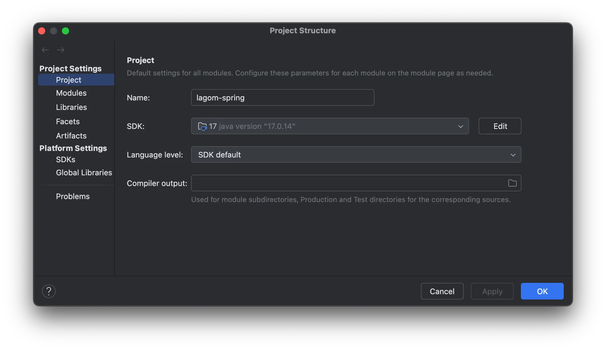
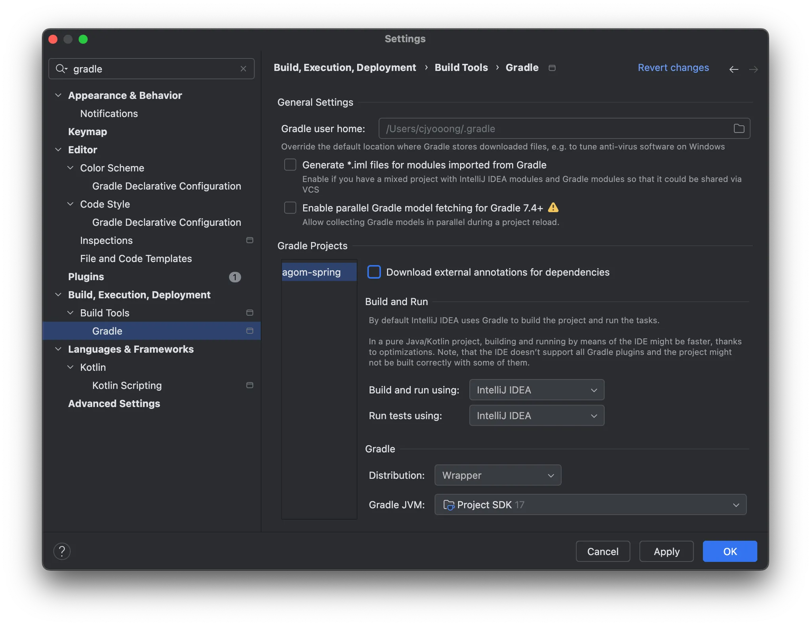
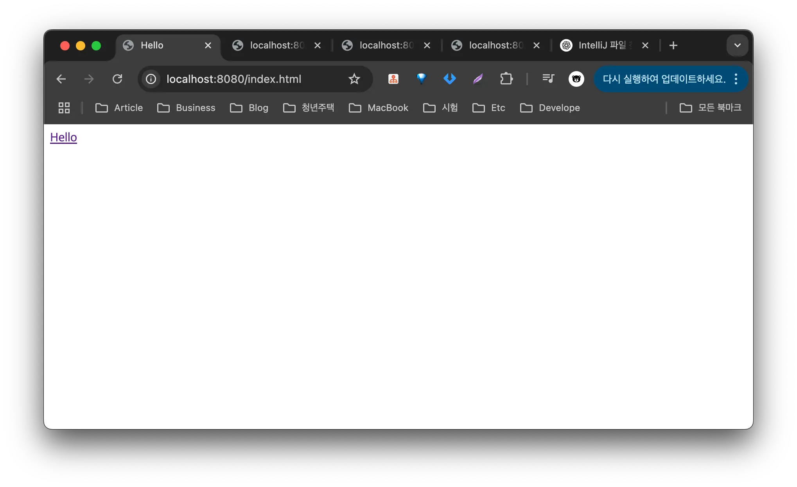
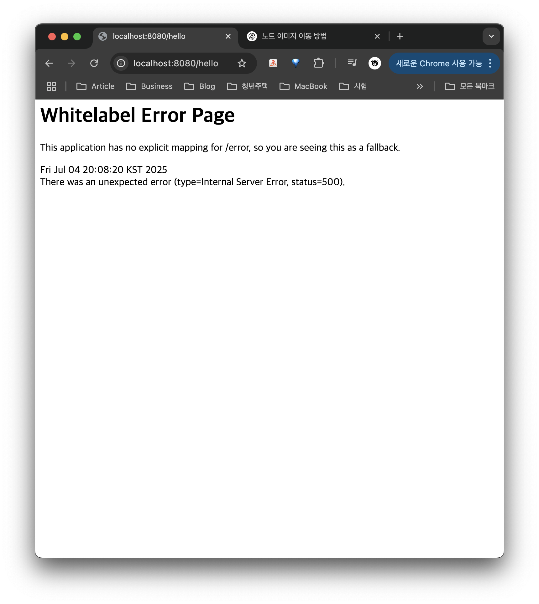
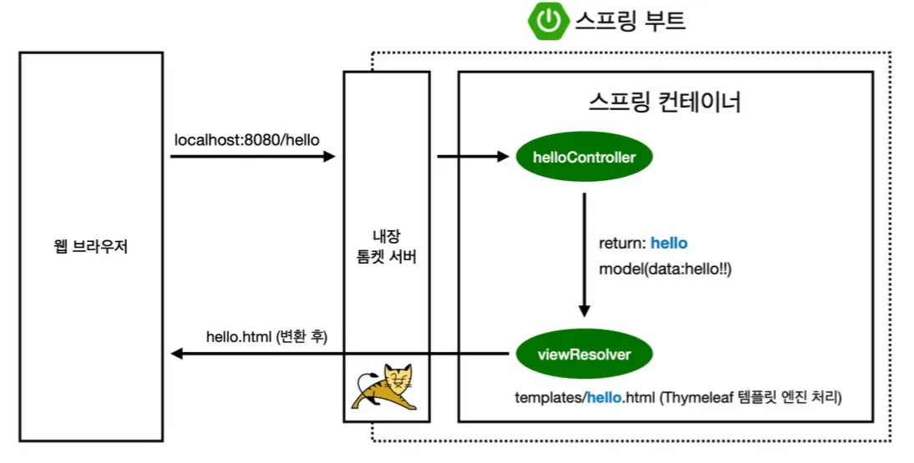
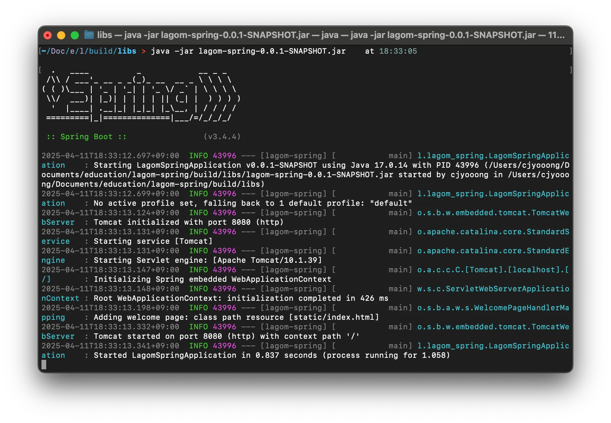
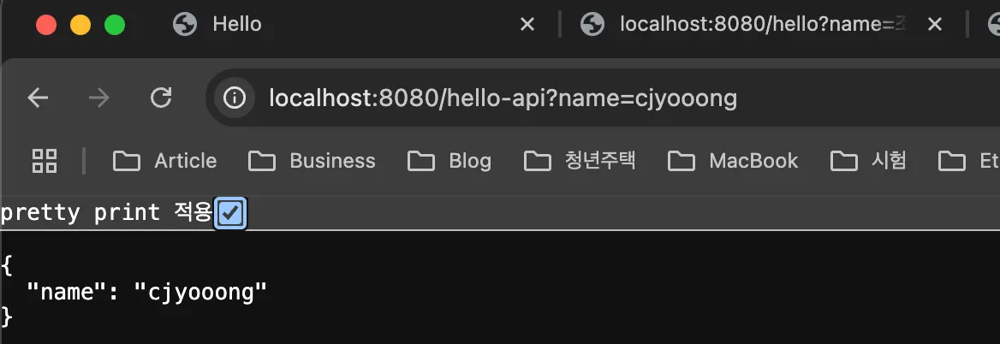

# [Spring] 스프링 핵심 원리

> 작성일: 2025-06-15 · 태그: 프레임워크/스프링, 기초

프로젝트를 구현하기 전에 기본적인 프로젝트 설정을 확인하자.

## 프로젝트 JDK 설정
Mac : File -> Project Structure (command + ;)
Windows : File -> Project Structure (ctrl + alt + shift + s)

- 현재 프로젝트 기준 JDK 17버전으로 설정이 되어 있는지 확인.

## Gradle JDK 설정
Mac : File -> Setting(command + ,)
Windows : File -> Setting(ctrl + alt + s)

- Gradle Projects의 Build and run using, Run tests using 설정을 IntelliJ IDEA로 설정하는 것이 실행 속도가 더 빠르다.
	(최근 IntelliJ 버전은 Gradle을 통해서 실행하는 것이 기본 설정이다.)
- Gradle JVM을 현재 프로젝트 버전인 17로 설정 했는지 확인


[Project JDK와 Gradle JDK 차이점](reference/Project%20JDK%EC%99%80%20Gradle%20JDK%20%EC%B0%A8%EC%9D%B4%EC%A0%90.md)


## Hello 페이지 만들기
### ViewResolver없이 바로 페이지 호출(정적 컨텐츠)
resources/static/index.html
```html
<!doctype html>
<html lang="en">
<head>
    <meta charset="UTF-8">
    <meta name="viewport" content="width=device-width, initial-scale=1">
    <title>Hello</title>
</head>
<body>
<a href="/hello">Hello</a>
</body>
</html>
```
- 사용자에게 보여줄 HTML 화면 생성

http://localhost:8080/index.html


- 위의 url로 브라우저에 요청하면 사용자에게 보여주기 위해 만든 HTML화면을 만들 수 있다.

### ViewResolver 통해 페이지 호출(MVC와 템플릿 엔진)

resources/templates/hello.html

```Html
<!DOCTYPE html>
<html xmlns:th="http://www.thymeleaf.org">
<body>
<p th:text="${name} + ' hello!!'">name hello!!</p>
</body>
</html>
```

- html 태그에 타임리프 템플릿엔진 설정
```Html
<html xmlns:th="http://www.thymeleaf.org">
```

- 컨트롤러에서 받아와 호면에 보여줄 값 설정

```Html
<p th:text="${name} + ' hello!!'">name hello!!</p>
```

java/lagom/lagom_spring/controller/HelloController.java

```java
@Controller
@RequestMapping("/my")
public class HelloController {

    @GetMapping("hello")
    public String hello(@RequestParam("name") String name, Model model) {
        // @RequestParam 추가로 name을 path 파라미터롤 이용
        model.addAttribute("name", name);
        return "hello";
    }
}
```

#### 코드분석
 **`@Controller`**
- Spring MVC에서 이 클래스를 컨트롤러로 등록하겠다는 뜻이다.
- 이 클래스는 웹 요청을 받아 처리하는 역할.
- 컨트롤러는 요청(HTTP)을 받아 처리하고, 모델(Model)을 뷰(View)에 넘겨주는 중간 역할을 한다.
- <span style="color:orange;">@Contoller가 붙지 않으면 Get요청을 보내도 프레임워크에서 받질 않는다.</span>

`@RequestMapping("/my")`
- base path를 지정할때 controller에 붙여 사용한다.
- 예를 들어 /hello라는 요청이 다른 모듈이나 기능에서 호출해야할때 base path로 구분을 준다고 생각하면 쉽다.

**`@GetMapping("hello")`**
- Get방식의 `/hello` URL요청을 처리하는 메서드에 붙는 어노테이션.
- 예 : `http://localhost:8080/hello?name=홀길동` 요청이 여기에 매핑.

**`@RequestParam("name") String name`**
```java
public String hello(@RequestParam("name") String name, Model model)
```
- 쿼리 파라미터에서 `name`값을 추출해서 `String name` 변수에 바인딩.
- 예 : `/hello?name=홍길동` -> `name="홀길동"`으로 들어감
- URL파라미터 = ?key=value 형식의 쿼리 스트링

**`Model model`**
- 뷰에 데이터를 넘겨주는 Spring의 모델 객체이다.
- `model.addAttribute(...)` 하면, 템플릿(Thymeleaf 등) 에서 해당 데이터를 사용할 수 있다.

**`model.addAttribute("name", name);`**
- 템프릿에서 사용할 데이터 키를 `"name"`으로 설정하고, 값은 요청 파라미터에서 받은 값.
- 뷰 파일에서는 `${name}`으로 접근 가능(예 : Thymeleaf)

**`return "hello";`**
- `resources/templates/hello.html`파일을 찾아서 렌더링해준다.
- 확장자는 생략하고 뷰 이름만 반환
- SpringBoot + Thymeleaf구조에서는 `return "hello"` -> `hello.html`로 렌더링
- return "뷰이름", 뷰이름에 존재하지 파일이 없으면 아래와 같이 오류페이지가 발생한다.
	

[스프링부트 Flow](reference/%EC%8A%A4%ED%94%84%EB%A7%81%EB%B6%80%ED%8A%B8%20Flow.md)


## 빌드하고 실행하기
1. 프로젝트 경로로 이동
    `cd /lagom-spring`
    
2. 빌드
    `./gradlew build`
    `./gradlew clean → ./gradlew build`
    `./gradlew clean build`
    
3. 라이브러리 파일 경로 이동
    `cd ./build/libs`
    
4. 라이브러리 파일 실행
    `java -jar lagom-spring-0.0.1-SNAPSHOT.jar`
	콘솔로 프로젝트가 실행된 모습을 확인할 수 있다.

## 웹 페이지 API로 호출(JSON)
전 단계와 동일하게 웹페이지를 호출하되 반환값을 String형식이 아닌 객체를 반환해보자.

java/lagom/lagom_spring/controller/HelloController.java
```java
@Controller
public class HelloController {
    @GetMapping("hello-api")
    @ResponseBody
    public Hello helloApi(@RequestParam("name") String name) {

        // @ResponseBody를 사용하고 객체를 반환하면 객체가 JSON으로 변환
        Hello hello = new Hello();
        hello.setName(name);
        return hello;
    }

    static class Hello {
        String name;

        public String getName() {
            return name;
        }

        public void setName(String name) {
            this.name = name;
        }
    }
}
```
- `@ResponseBody`를 사용하고, 객체를 반환하면 객체가 JSON으로 변환됨.

http://localhost:8080/hello-api?name=cjyooong


다음부터 나오는 SpringBoot에 대한 내용은 아래 내용을 먼저 읽어보고 진행하는 것이 이해하는데 도움이 될 것이다.

[컴포넌트 스캔과 자동 의존관계 설정](advanced/%EC%BB%B4%ED%8F%AC%EB%84%8C%ED%8A%B8%20%EC%8A%A4%EC%BA%94%EA%B3%BC%20%EC%9E%90%EB%8F%99%20%EC%9D%98%EC%A1%B4%EA%B4%80%EA%B3%84%20%EC%84%A4%EC%A0%95.md)
