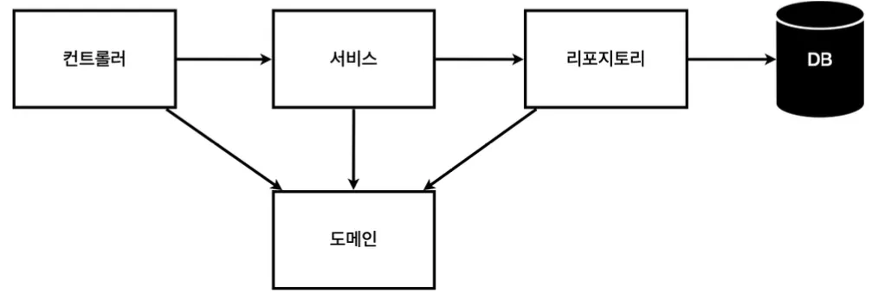
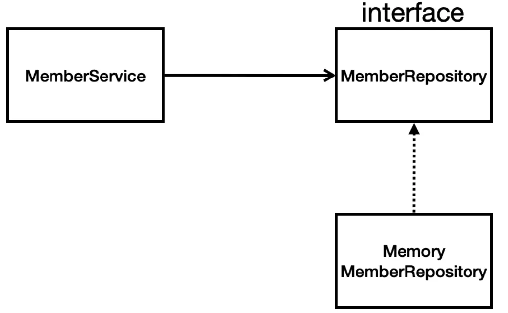

# [Spring] 회원 도메인 개발 및 테스트케이스

> 작성일: 2025-06-22 · 태그: 프레임워크/스프링, 기초

## 요구사항 정리
회원 도메인 구현에 앞서 요구사항을 정리해보자.

실무적으로 어떤 모듈과 기능을 개발하더라도 사용자의 요구사항 정리는 꼭 필요한 단계이다. 아무런 요구사항과 계획이 없는 상태에서는 그 어떤 무엇도 개발할 수 없다.

##### 요구사항
- 데이터 : 회원ID, 이름
- 기능 : 회원 등록, 조회
- 아직 데이터 저장소가 선정되지 않음.(가상 시나리오)

##### 웹 어플리케이션 계층 구조

- 컨트롤러 : 웹 MVC의 컨트롤러 역할
- 서비스 : 핵심 비즈니스 로직 구현
- 리포지토리 : 데이터베이스에 접근, 도메인 객체를 DB에 저장하고 관리
- 도메인 : 비즈니스 도메인 객체
	ex) 회원, 주문, 쿠폰 등 주로 데이터베이스에 저장하고 관리

## 회원 리포지토리 구현
##### 클래스별 의존관계


##### 1. 회원객체
서비스 및 리포지토리에서 사용할 회원(Member) 객체 생성
```java
package lagom.lagom_spring.domain;

public class Member {

    private Long id;
    private String name;

    public Long getId() {
        return id;
    }

    public void setId(Long id) {
        this.id = id;
    }

    public String getName() {
        return name;
    }

    public void setName(String name) {
        this.name = name;
    }
}
```

##### 2. 회원 리포지토리 인터페이스 생성
구현체에서 사용할 함수 등을 선언하는 인터페이스 생성
```java
package lagom.lagom_spring.repository;

import lagom.lagom_spring.domain.Member;
import java.util.List;
import java.util.Optional;

public interface MemberRepository {

    Member save(Member member);
    Optional<Member> findById(Long id);
    Optional<Member> findByName(String name);
    List<Member> findAll();
}
```

> [!NOTE]
> **Java에서 Optional을 사용하는 이유?**
> NullPointerException(NPE)을 방지하고 명시적으로 값이 없을 수 있음을 표현하기 위해. Java 8부터 도입된 Optional<>은 null을 직접 다루는 대신 안전하고 명확하게 값이 있을 수도 없을 수도 있다는 상황을 표현할 수 있게 해준다.

```java
	// null을 이용한 유효성 체크
	public String getUserEmail(User user) {
		if(user != null && user.getEmail() != null) {
			return user.getEmail();
		}else {
			return "이메일 없음";
		}
	}
```
```java
	// Optional을 이용한 체크
	public Optional<String> getUserEmail(User user) {
	    return Optional.ofNullable(user)
                   .map(User::getEmail);
	}
```

##### 3. 회원 리포지토리 메모리 구현체
회원 리포지토리 인터페이스를 상속받아 선언된 함수를 재사용한다.
```java
package lagom.lagom_spring.repository;

import lagom.lagom_spring.domain.Member;
import java.util.*;

/**
 * 동시성 문제가 고려되어 있지 않음, 실무에서는 ConcurrentHashMap, AtomicLong 사용 고려
 */
public class MemoryMemberRepository implements MemberRepository{

    private static Map<Long, Member> store = new HashMap<>();
    private static Long sequence = 0L;

    @Override
    public Member save(Member member) {
        member.setId(++sequence);
        store.put(member.getId(), member);
        return member;
    }

    @Override
    public Optional<Member> findById(Long id) {
        return Optional.ofNullable(store.get(id));
    }

    @Override
    public Optional<Member> findByName(String name) {
        return store.values().stream()
                .filter(member -> member.getName().equals(name))
                .findAny();
    }

    @Override
    public List<Member> findAll() {
        return new ArrayList<>(store.values());
    }

    public void clearStore() {
        store.clear();
    }
}
```

**상세설명**
1. 회원저장소
	```java
	private static Map<Long, Member> store = new HashMap<>();
	private static Long sequence = 0L;
	```
	- DB가 없기 때문에 데이터 형식의 store객체 생성

2. 회원 저장
	```java
	@Override
	  public Member save(Member member) {
		  member.setId(++sequence);
	      store.put(member.getId(), member);
	      return member;
	  }
	```
	- save함수 사용시 Member객체를 전달받게 함.
	- 전달받은 Member객체에 ID 세팅
	- store에 Member객체의 ID와 객체를 할당
	- member 객체 반환

3. 회원 조회(단일)
	```java
		@Override
	public Optional<Member> findById(Long id) {
	    return Optional.ofNullable(store.get(id));
	}	
	```
	- 전달받은 ID파라미터로 store에 저장되어 있는 member객체 조회
	- Optional.ofNullable:
	```less
		public static <T> Optional<T> ofNullable(T value)
		- value가 null이 아니면: Optional.of(value)처럼 Optional 객체를 생성합니다.
		- value가 null이면: 비어 있는 Optional.empty()를 반환합니다.
	```
	
4. 회원 조회(단일_이름으로)
	```java
		@Override
		public Optional<Member> findByName(String name) {
		    return store.values().stream()
		              .filter(member -> member.getName().equals(name))
		              .findAny();
		}
	```
	
	- .stream() : store에 담긴 Member객체들을 Collection형태로 가져옴
	- .filter() : name 전달받은 값과 동일한 member객체를 통과
	- .findAny() : 조건을 통과한 Member . 중아무거나 하나를 찾아서 `Optional<Member>`로 감싸 반환해
	
5. 회원 조회(전체)
	```java
		@Override
		public List<Member> findAll() {
		    return new ArrayList<>(store.values());
		}
	```
	- store에 저장된 Member객체들을 리스트에 담아서 반환

## 테스트 케이스 작성 및 확인

개발한 기능을 실행해서 테스트 할 때 자바의 main 메서드를 통해서 실행하거나, 웹 애플리케이션의 컨트롤러를 통해서 해당 기능을 실행한다. 이러한 방법은 준비하고 실행하는데 오래 걸리고, 반복 실행하기 어렵고 여러 테스트를 한번에 실행하기 어렵다는 단점이 있다.

자바는 JUnit이라는 프레임워크로 테스트를 실행해서 이러한 문제를 해결한다.

/src/test/java 하위 폴더에 생성한다.

```java
package lagom.lagom_spring.repository;

import lagom.lagom_spring.domain.Member;
import org.junit.jupiter.api.AfterAll;
import org.junit.jupiter.api.AfterEach;
import org.junit.jupiter.api.Test;

import java.util.List;

import static org.assertj.core.api.Assertions.*;

/**
 * 회원 레포지토리 메모리 구현체 테스트
 */
class MemoryMemberRepositoryTest {

    MemoryMemberRepository repository = new MemoryMemberRepository();

    @AfterEach
    public void afterEach() {
        repository.clearStore();
    }

    @Test
    public void save() {
        //given
        Member member = new Member();
        member.setName("lagom1");

        //when
        repository.save(member);

        //then
        Member result = repository.findById(member.getId()).get();
        assertThat(result);
    }

    @Test
    public void findByName() {
        //given
        Member member1 = new Member();
        member1.setName("lagom1");
        repository.save(member1);

        Member member2 = new Member();
        member2.setName("lagom2");
        repository.save(member2);

        //when
        Member result = repository.findByName("lagom1").get();

        //then
        assertThat(result).isEqualTo(member1);
    }

    @Test
    public void findAll() {
        //given
        Member member1 = new Member();
        member1.setName("lagom1");
        repository.save(member1);

        Member member2 = new Member();
        member2.setName("lagom2");
        repository.save(member2);

        //when
        List<Member> result = repository.findAll();

        //then
        assertThat(result.size()).isEqualTo(2);

    }
}
```

- 각각의 함수별 @Test 어노테이션을 붙여 테스트코드를 만들어 실행.

```java
@AfterEach
public void afterEach() {
    repository.clearStore();
}
```

- afterEach함수는 각 테스트가 진행한 후 store를 지워주는 역할을 한다.
- 만약 각 테스트가 진행된 후 store가 지워지지 않으면 다음 테스트에 store 데이터가 존재하여 원하는 테스트 결과가 나오지 않을 수 있다.
- 꼭 @AfterEach 어노테이션을 붙여야한다.

## 회원서비스 구현

```java
package lagom.lagom_spring.service;

import lagom.lagom_spring.domain.Member;
import lagom.lagom_spring.repository.MemberRepository;
import lagom.lagom_spring.repository.MemoryMemberRepository;

import java.util.List;
import java.util.Optional;

public class MemberService {

    private final MemberRepository memberRepository;

    /**
     * MemberRepository를 직접 선언하는 것이 아닌 외부에서 넘겨주게 생성자 생성
     * @param memberRepository
     */
    public MemberService(MemberRepository memberRepository) {
        this.memberRepository = memberRepository;
    }

    /**
     * 회원가입
     * @param member
     * @return
     */
    public Long join(Member member) {
        //중복된 회원은 가입할 수 없다라고 가정.
        /*Optional<Member> result =  memberRepository.findByName(member.getName());
        result.ifPresent(m -> {
            throw new IllegalStateException("이미 존재하는 회원입니다.");
        });*/

        //중복된 회원은 가입할 수 없다라고 가정.
        validateDuplicateMember(member);

        memberRepository.save(member);
        return member.getId();
    }

    /**
     * Ctrl + T 로 Extra Method를 생성하여 분리
     */
    private void validateDuplicateMember(Member member) {
        memberRepository.findByName(member.getName())
                        .ifPresent(m -> {
                            throw new IllegalStateException("이미 존재하는 회원입니다.");
                        });
    }

    /**
     * 전체 회원 조회
     */
    public List<Member> findMembers() {
        return memberRepository.findAll();
    }

    public Optional<Member> findOne(Long memberId) {
        return memberRepository.findById(memberId);
    }
}

```

```java
private final MemberRepository memberRepository;

/**
 * MemberRepository를 직접 선언하는 것이 아닌 외부에서 넘겨주게 생성자 생성
 * @param memberRepository
 */
public MemberService(MemberRepository memberRepository) {
    this.memberRepository = memberRepository;
}
```

- 생성자객체를 생성하여 MemberService를 호출할 때 MemberRepository 넘겨주어 repository를 전역변수에 할당하게 한다.
- 이렇게 사용하는 이유는 MemberService를 호출할때 각각으로 호출하면 repository를 다르게 사용하여 싱크가 맞지 않을 수 있기 때문이다.
- 생성자 주입을 통해 의존성을 직접만들지 않고 밖에서 주입받아 결합도는 낮추고 테스트가 쉬워짐.

## 회원서비스 테스트코드

```java
package lagom.lagom_spring.service;

import lagom.lagom_spring.domain.Member;
import lagom.lagom_spring.repository.MemoryMemberRepository;
import org.assertj.core.api.Assertions;
import org.junit.jupiter.api.AfterEach;
import org.junit.jupiter.api.BeforeEach;
import org.junit.jupiter.api.Test;

import static org.junit.jupiter.api.Assertions.*;

class MemberServiceTest {

    MemberService memberService;
    MemoryMemberRepository memberRepository;

    @BeforeEach
    public void beforeEach() {
        memberRepository = new MemoryMemberRepository();
        memberService = new MemberService(memberRepository);
    }

    @AfterEach
    public void afterEach() {
        memberRepository.clearStore();
    }

    /**
     * 테스트 코드 작성시 given -> when -> then 순으로 파라미터, 시점, 결과를 확인하는 것이 좋다.
     */
    @Test
    void 회원가입() {
        //given
        Member member = new Member();
        member.setName("lagom");

        //when
        Long saveId = memberService.join(member);

        //then
        Member findMember = memberService.findOne(saveId).get();
        Assertions.assertThat(member.getName()).isEqualTo(findMember.getName());
    }

    @Test
    public void 중복_회원_예외() {
        //given
        Member member1 = new Member();
        member1.setName("lagom");

        Member member2 = new Member();
        member2.setName("lagom");

        //when
        memberService.join(member1);

        //예외 테스트 방법2
        //assertThrows(IllegalStateException.class, () -> memberService.join(member2));
        //assertThrows(NullPointerException.class, () -> memberService.join(member2));

        //예외 테스트 메시지 테스트
        IllegalStateException e = assertThrows(IllegalStateException.class, () -> memberService.join(member2));
        Assertions.assertThat(e.getMessage()).isEqualTo("이미 존재하는 회원입니다.");

        //예외 테스트 방법1
        /*try {
            memberService.join(member2);
            fail();
        } catch (IllegalStateException e) {
            Assertions.assertThat(e.getMessage()).isEqualTo("이미 존재하는 회원입니다.");
        }*/

        //then
    }

    @Test
    void findMembers() {
    }

    @Test
    void findOne() {
    }
}
```

```java
MemberService memberService;
MemoryMemberRepository memberRepository;

@BeforeEach
public void beforeEach() {
    memberRepository = new MemoryMemberRepository();
    memberService = new MemberService(memberRepository);
}
```

- 테스트 전 beforeEach를 수행하게 하여 memberRepository를 세팅하여
    
    모든 함수에서 동일한 repository를 사용하게 한다.
